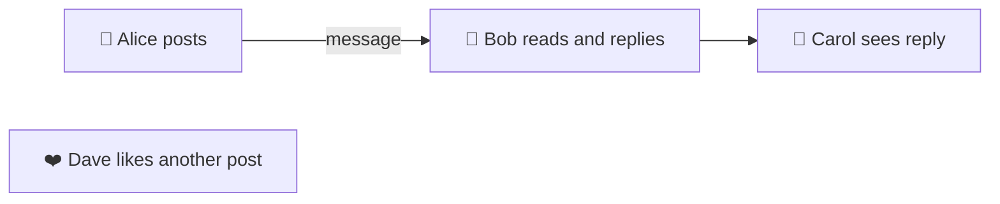

# 08 · Logical Clocks

> [!info] Topic info
> **Subject:** System Design · **Chapter:** Distributed Systems · **Priority:** 💤 Low · **Status:** ✅ done · **Last reviewed:** 2026-11-19
>
> [← Back to Distributed Systems](README.md) · [Interview questions →](questions/distributed-systems-qa.md)

> [!abstract] In one line
> A **logical clock** orders events with **counters instead of real time**, capturing **"happened-before"** — what could have caused what.

---

## 1. The problem

[Physical clocks](07-clock-synchronization.md) drift, so timestamps can't tell us which write came first across servers. But often we don't need the **exact time** — only the **order**: did the reply come after the post?

---

## 2. Happened-before

Event **A happened-before B** (written A → B) if:
- A and B are on the **same node** and A came first, or
- A is **sending** a message and B is **receiving** it, or
- there's a chain: A → X → B.

If neither A → B nor B → A, the events are **concurrent** — neither could have known about the other.

Post → reply → notification is a causal chain. Dave's like is **concurrent** with all of it.

---

## 3. The two main types

| | **Lamport timestamp** | **Vector clock** |
|---|---|---|
| **Size** | One number | One counter **per node** |
| **If A → B** | ts(A) < ts(B) ✅ | V(A) < V(B) ✅ |
| **Can detect concurrency?** | ❌ No | ✅ Yes |
| **Use** | Total order, tie-breaking | Detecting conflicts between replicas |

→ [Lamport Timestamps](09-lamport-timestamps.md) · [Vector Clocks](10-vector-clocks.md)

> [!tip] 🎤 Say it like this
> "Logical clocks replace wall time with counters that respect cause and effect. Lamport timestamps give a single number that's consistent with causality, good for a total order. Vector clocks keep a counter per node so you can also tell when two writes were concurrent, which is what you need to detect conflicts."

> [!failure] Interview traps
> - Thinking logical clocks tell you **real time** — they only tell **order**.
> - Thinking a smaller Lamport number means "happened before" — it doesn't; the events might be concurrent.

---

## Summary

- Order by **causality**, not by wall time.
- **Lamport** = small, total order, can't spot concurrency. **Vector** = bigger, spots concurrency.

> [!success] Key takeaway
> When you need "what came first" across machines, reach for logical clocks, not `now()`.
