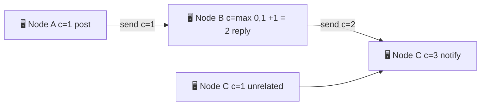

# 09 · Lamport Timestamps

> [!info] Topic info
> **Subject:** System Design · **Chapter:** Distributed Systems · **Priority:** 💤 Low · **Status:** ✅ done · **Last reviewed:** 2026-11-19
>
> [← Back to Distributed Systems](README.md) · [Interview questions →](questions/distributed-systems-qa.md)

> [!abstract] In one line
> A **Lamport timestamp** is a **single counter per node**, bumped on every event and **max-merged on every message**, giving an order that **never contradicts causality**.

---

## 1. The problem

We want every event in the cluster to have a number, so that if A caused B, A's number is smaller. Cheaply — one integer, no clock sync. → Background in [Logical Clocks](08-logical-clocks.md).

---

## 2. The rules

1. Each node keeps a counter `c`, starting at 0.
2. Before **any local event** (including sending): `c = c + 1`.
3. When **sending** a message, attach `c`.
4. When **receiving** a message with counter `m`: `c = max(c, m) + 1`.

The reply (2) is bigger than the post (1), and the notification (3) is bigger than both. ✅

### Total order with tie-break
Two events can have the same number. Break ties with **node ID**: compare `(counter, nodeId)`. Now **every** event has a unique position — useful for ordering a replicated log or deciding which lock request goes first.

---

## 3. The limitation

If A → B, then L(A) < L(B). But the **reverse is not true**: L(A) < L(B) does **not** mean A caused B — they might be concurrent.

So Lamport can't tell you "these two writes conflict". For that you need [Vector Clocks](10-vector-clocks.md).

> [!tip] 🎤 Say it like this
> "Each node keeps a counter. Increment it on every event, send it with every message, and on receive take the max of yours and the incoming one, plus one. That gives a total order consistent with causality. The catch is it can't detect concurrent events — a smaller number doesn't prove one caused the other."

> [!failure] Interview traps
> - Claiming L(A) < L(B) ⇒ A happened before B. Only the other direction holds.

---

## Summary

- One integer per node, `max + 1` on receive, tie-break with node ID.
- Gives a **total order consistent with causality**. Can't detect concurrency.

> [!success] Key takeaway
> Lamport = cheap ordering. Need conflict detection? Upgrade to vector clocks.
