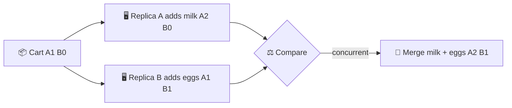

# 10 · Vector Clocks

> [!info] Topic info
> **Subject:** System Design · **Chapter:** Distributed Systems · **Priority:** 💤 Low · **Status:** ✅ done · **Last reviewed:** 2026-11-19
>
> [← Back to Distributed Systems](README.md) · [Interview questions →](questions/distributed-systems-qa.md)

> [!abstract] In one line
> A **vector clock** keeps **one counter per node**; comparing two vectors tells you if one write **came after** the other or if they are **concurrent** (a conflict).

---

## 1. The problem

In an AP database (see [CAP](../core-concepts/07-cap-theorem.md)), two users edit the same shopping cart on different replicas during a partition. When replicas sync, we must know: is one edit **newer**, or did they happen **at the same time** and need merging?

[Lamport timestamps](09-lamport-timestamps.md) can't answer that. Vector clocks can.

---

## 2. How it works

With 3 replicas A, B, C, each value carries a vector like `[A:2, B:1, C:0]`.

1. When a node updates a value, it bumps **its own** entry.
2. When nodes sync, take the **element-wise max** of the vectors.

### Comparing two vectors
- **V1 ≤ V2 in every slot** → V1 is older; V2 wins, no conflict.
- **Some slots bigger, some smaller** → **concurrent** → conflict, keep both ("siblings") and merge.

`[A:2, B:0]` vs `[A:1, B:1]` — A is bigger in one slot, B in another → concurrent. Merge both items.

> [!example] Where you'll see it
> Amazon's original **Dynamo** paper used vector clocks for the shopping cart. Riak used them too. Many modern systems use simpler variants (version vectors, dotted version vectors).

> [!tip] 🎤 Say it like this
> "A vector clock is a list of counters, one per node. Each node bumps its own slot on write, and you take the max when syncing. If one vector is less than or equal in every slot, it's older. If each is ahead somewhere, the writes were concurrent, so it's a real conflict and the app or a CRDT has to merge them."

**❌ Cons:** vectors grow with the number of nodes/clients — systems prune old entries, which can lose a little precision.

> [!failure] Interview traps
> - Saying vector clocks **resolve** conflicts — they only **detect** them. Merging is up to you or a [CRDT](17-crdts.md).

---

## Summary

- One counter per node; bump yours on write, element-wise max on sync.
- Compare → **older**, **newer**, or **concurrent** (conflict).

> [!success] Key takeaway
> Vector clocks answer "is this a conflict?" — the one question Lamport timestamps can't.
