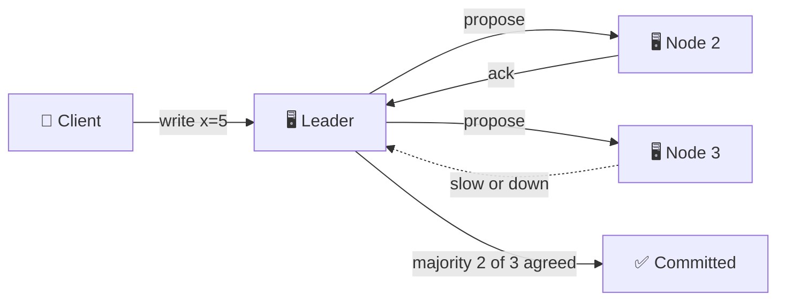

# 11 · Consensus

> [!info] Topic info
> **Subject:** System Design · **Chapter:** Distributed Systems · **Priority:** 🔥 High · **Status:** ✅ done · **Last reviewed:** 2026-11-19
>
> [← Back to Distributed Systems](README.md) · [Interview questions →](questions/distributed-systems-qa.md)

> [!abstract] In one line
> **Consensus** is how a group of nodes **agree on one value** (or one order of operations) even when some nodes **crash** or the network is flaky — using a **majority quorum**.

---

## 1. The problem

Our app has 3 config servers. An admin sets `feature_x = on`. At the same moment another admin sets `feature_x = off`. One server gets "on" first, another gets "off" first.

Now servers disagree, and some users see the feature and some don't. We need all nodes to agree on **one answer, in one order**, even if a node dies mid-way.

---

## 2. What consensus guarantees

- **Agreement** — all healthy nodes decide the **same** value.
- **Validity** — the value was actually proposed by someone (no made-up answers).
- **Termination** — healthy nodes **eventually** decide.
- **Fault tolerance** — keeps working as long as a **majority** is up.

Most real systems use it to agree on a **replicated log**: "operation #1 is X, #2 is Y…". If every node applies the same log in the same order, they all end in the same state. This is called **state machine replication**.

---

## 3. Quorum — why a majority

A **quorum** is more than half the nodes. Any two majorities **overlap** in at least one node, so a decision made by one majority is always seen by the next one.

| Cluster size | Majority | Failures tolerated |
|---|---|---|
| **3** | 2 | 1 |
| **5** | 3 | 2 |
| **7** | 4 | 3 |
| **4** | 3 | 1 (no better than 3!) |

> [!important] Use odd numbers
> A 4-node cluster tolerates only 1 failure, same as 3 — but it's slower and costs more. Use **3 or 5** (sometimes 7). More nodes = more fault tolerance but **slower writes**, since more acks are needed.

---

## 4. The FLP result (one line)

**FLP impossibility:** in a fully asynchronous network where even one node may crash, no algorithm can **guarantee** it always reaches agreement in bounded time.

In practice, Raft and Paxos dodge this with **timeouts** and randomness: they're always **safe** (never disagree) and are **live** (make progress) whenever the network behaves reasonably.

---

## 5. Where it's used

| Use | System |
|---|---|
| **Config + service discovery** | etcd (Kubernetes), ZooKeeper, Consul |
| **Leader election** | Kafka (KRaft), HDFS, many DBs — see [Leader Election](14-leader-election.md) |
| **Distributed locks** | etcd, ZooKeeper — see [Distributed Locks](15-distributed-locks.md) |
| **Strongly consistent DBs** | Spanner, CockroachDB, TiDB, YugabyteDB |

Algorithms: [Paxos](12-paxos.md) (the classic), [Raft](13-raft.md) (the understandable one), ZAB (ZooKeeper's).

> [!tip] 🎤 Say it like this
> "Consensus gets a group of nodes to agree on one value or one ordered log, even if some crash. It works by majority quorum — with 5 nodes, 3 must agree, so it survives 2 failures, and any two majorities overlap so decisions are never lost. I don't build it myself; I use etcd or ZooKeeper for leader election, locks and config."

**✅ Pros**
- Strong consistency, survives minority failures, no split brain.

**❌ Cons**
- Every write needs a round trip to a majority → **higher latency** (worse across regions).
- Unavailable if a majority is down or partitioned away.
- Doesn't scale writes — every write goes through one leader.

> [!failure] Interview traps
> - Saying you'll **write your own** consensus algorithm. Use a proven one.
> - Putting high-volume app data in etcd/ZooKeeper — they're for small, critical **metadata**.
> - Thinking more nodes = faster. More nodes = **slower** writes, more fault tolerance.
> - Confusing consensus with [2PC](../distributed-transactions/02-two-phase-commit.md): 2PC needs **all** participants to say yes; consensus needs a **majority**.

---

## Summary

- Consensus = agree on one value / one log order despite failures.
- **Majority quorum**: 2f+1 nodes tolerate f failures. Use odd sizes.
- **FLP**: no perfect guarantee in async networks; timeouts make it work in practice.
- Used for leader election, locks, config, strongly consistent DBs.

> [!success] Key takeaway
> When you need **one source of truth** that survives failures, put that small piece of state behind consensus (etcd/ZooKeeper) and keep everything else simple.
