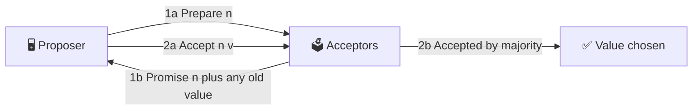

# 12 · Paxos

> [!info] Topic info
> **Subject:** System Design · **Chapter:** Distributed Systems · **Priority:** 💤 Low · **Status:** ✅ done · **Last reviewed:** 2026-11-19
>
> [← Back to Distributed Systems](README.md) · [Interview questions →](questions/distributed-systems-qa.md)

> [!abstract] In one line
> **Paxos** is the classic [consensus](11-consensus.md) algorithm: a **proposer** gets a **majority of acceptors** to promise, then to accept, a numbered proposal — safe even with crashes and lost messages.

---

## 1. The problem

Several nodes may propose different values at the same time, and some may crash mid-way. Paxos makes sure the cluster ends up with **exactly one** chosen value, never two.

---

## 2. Roles

- **Proposer** — suggests a value.
- **Acceptor** — votes. A majority of acceptors decides.
- **Learner** — finds out the chosen value.

(One node usually plays all three roles.)

---

## 3. Two phases

1. **Prepare / Promise** — proposer picks a unique number `n` and asks: "Promise to ignore anything lower than `n`?" Acceptors promise, and report any value they already accepted.
2. **Accept / Accepted** — if a majority promised, proposer sends `Accept(n, v)`. If any acceptor reported an earlier value, the proposer **must reuse that value**. Once a majority accepts, `v` is chosen.

That "must reuse the old value" rule is what makes Paxos safe: once something might be chosen, nobody can override it.

---

## 4. In practice

- Basic Paxos picks **one** value. Real systems use **Multi-Paxos**: elect a stable leader and skip phase 1 for each new log entry.
- Known as **hard to understand and implement** — that's why [Raft](13-raft.md) was created.
- Used in Google Chubby and Spanner; Cassandra uses it for lightweight transactions.

> [!tip] 🎤 Say it like this
> "Paxos has two phases. First a proposer gets a majority to promise to ignore lower-numbered proposals, and learns any value already accepted. Then it asks the majority to accept a value — reusing the old one if there was one. Majority overlap guarantees only one value is ever chosen. Multi-Paxos adds a stable leader for efficiency, and Raft is the easier-to-understand alternative."

> [!failure] Interview traps
> - Spending interview time on Paxos details — knowing **the two phases + majority + why Raft exists** is enough.
> - Two dueling proposers can keep outbidding each other (livelock) — fixed with a leader and random backoff.

---

## Summary

- Roles: proposer, acceptor, learner. Phases: **prepare/promise**, **accept/accepted**.
- Safe by majority overlap; **Multi-Paxos** for logs; Raft is the friendlier version.

> [!success] Key takeaway
> Paxos = proven but tricky. In interviews, name it, sketch two phases, then say "in practice I'd use Raft-based etcd".
