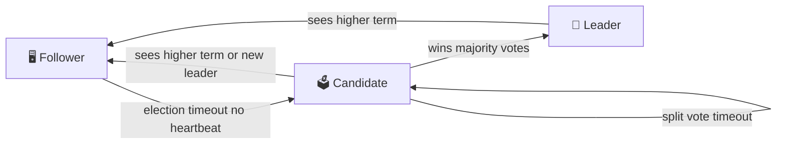
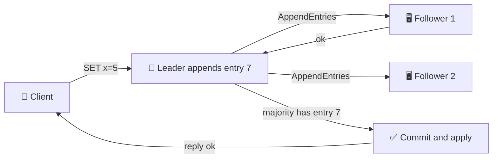

# 13 · Raft

> [!info] Topic info
> **Subject:** System Design · **Chapter:** Distributed Systems · **Priority:** ⚡ Medium · **Status:** ✅ done · **Last reviewed:** 2026-11-19
>
> [← Back to Distributed Systems](README.md) · [Interview questions →](questions/distributed-systems-qa.md)

> [!abstract] In one line
> **Raft** is a [consensus](11-consensus.md) algorithm built to be **easy to understand**: one **leader** per **term** takes all writes, **replicates its log** to followers, and commits once a **majority** has it.

---

## 1. The problem

[Paxos](12-paxos.md) works but is famously hard to get right. Raft splits consensus into three clear pieces: **leader election**, **log replication**, and **safety**. It powers etcd, Consul, CockroachDB, TiKV and Kafka's KRaft.

---

## 2. Roles and terms

Every node is in one of three states:
- **Follower** — passive, replies to the leader.
- **Candidate** — trying to become leader.
- **Leader** — handles all client writes, sends heartbeats.

Time is split into **terms** (1, 2, 3…). Each term has **at most one leader**. The term number acts as a [fencing token](05-handling-failures.md): any message with an older term is ignored.

---

## 3. Leader election

1. Followers expect a **heartbeat** from the leader (e.g. every 50 ms).
2. If none arrives within a **random election timeout** (e.g. 150–300 ms), the follower becomes a candidate, **bumps the term**, votes for itself, and asks others for votes.
3. Each node gives **one vote per term**, and only to a candidate whose log is **at least as up-to-date** as its own.
4. Majority of votes → **leader**. It starts sending heartbeats.

> [!note] Why the timeout is random
> If all followers timed out at the same moment, they'd all become candidates and split the vote forever. Randomness means one usually wakes up first and wins.

---

## 4. Log replication

1. Client sends a write to the leader. Leader **appends** it to its log.
2. Leader sends `AppendEntries` to followers (this message doubles as the heartbeat).
3. Once a **majority** has stored the entry, it's **committed**. Leader applies it and replies to the client.
4. Followers apply committed entries in the same order → identical state.

If a follower's log differs, the leader **overwrites** the follower's extra entries with its own. Committed entries are never lost, because a new leader must have every committed entry (the "up-to-date log" voting rule).

> [!tip] 🎤 Say it like this
> "Raft has one leader per term. Followers that stop hearing heartbeats wait a random timeout, become candidates, bump the term, and ask for votes; a majority makes them leader. The leader appends each write to its log, replicates it, and commits once a majority has it. Only nodes with up-to-date logs can win, so committed data is never lost."

> [!failure] Interview traps
> - Thinking followers serve **strongly consistent reads** by default — they can be stale. Linearizable reads go through the leader (with a quorum check or lease).
> - Saying a write is committed when the **leader** stores it — it's committed when a **majority** does.
> - Even-sized clusters — no extra fault tolerance.

---

## Summary

| Piece | Key idea |
|---|---|
| **Terms** | Logical epochs; at most one leader each; old terms rejected |
| **Election** | Random timeout → candidate → majority votes → leader |
| **Replication** | Leader appends, majority stores → committed |
| **Safety** | Only up-to-date nodes can be elected |

> [!success] Key takeaway
> Raft = **leader + terms + majority-committed log**. Know the election and replication flow and you've covered 95% of interview questions.
