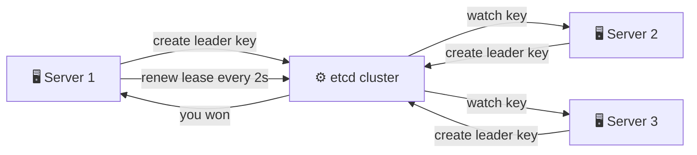

# 14 · Leader Election

> [!info] Topic info
> **Subject:** System Design · **Chapter:** Distributed Systems · **Priority:** 🔥 High · **Status:** ✅ done · **Last reviewed:** 2026-11-19
>
> [← Back to Distributed Systems](README.md) · [Interview questions →](questions/distributed-systems-qa.md)

> [!abstract] In one line
> **Leader election** picks **exactly one node** to be in charge (take writes, run a job, coordinate), and picks a **new one automatically** when it fails.

---

## 1. The problem

Our app sends a daily "memories" email to 50 M users. We run the job on 3 servers for redundancy. Without coordination, **all 3 send it** → users get 3 emails.

We want: one server does it, and if that server dies, another takes over within seconds. That's leader election.

---

## 2. Why have a leader at all?

A single leader makes many problems **simple**:
- **One writer** → no write conflicts (DB primary, Kafka partition leader).
- **One scheduler** → each cron job runs once.
- **One coordinator** → one node assigns shards/tasks to workers.

The cost: the leader is a **bottleneck** and a **SPOF** until a new one is elected — see [Single Point of Failure](../core-concepts/04-single-point-of-failure.md).

---

## 3. How to elect — three common ways

### A. Use a consensus service (most common, recommended)
Each candidate tries to create the same key in **etcd / ZooKeeper / Consul** with a **lease** (TTL). Whoever creates it is leader. The leader keeps renewing the lease. If it dies, the lease expires, the key disappears, and others race again.

ZooKeeper variant: each node creates an **ephemeral sequential** node; the **lowest number** is leader, and each node watches only the one just before it (avoids a herd of wake-ups).

### B. Built into a consensus algorithm
[Raft](13-raft.md) and Multi-Paxos elect a leader as part of the protocol: random timeouts, majority votes, terms.

### C. Classic algorithms (textbook)
- **Bully algorithm** — the node with the **highest ID** that's alive becomes leader. Simple but chatty and bad with flaky nodes.
- **Ring algorithm** — pass an election message around a ring; highest ID wins.

Good to name, rarely used in production — they don't handle partitions well.

> [!tip] 🎤 Say it like this
> "For leader election I wouldn't roll my own. Each instance tries to grab a lease key in etcd or ZooKeeper; the winner is leader and keeps renewing it. If it dies, the lease expires and another instance takes over. Every leadership change gets a higher epoch number, which I pass to downstream systems as a fencing token so a stale leader can't do damage."

---

## 4. The hard part — two leaders at once

A leader can **think** it's still leader after it isn't: a long GC pause, the lease expired, a new leader was elected, then the old one wakes up.

Defenses:
- **Fencing tokens / epochs** — each new leader gets a higher number; storage rejects older ones. See [Split Brain](03-split-brain.md).
- **Lease check before acting** — leader stops acting a safety margin **before** its lease runs out (assumes clocks don't run wildly fast).
- **Majority quorum** — a leader on the minority side of a partition can't renew its lease.

**✅ Pros:** simple coordination, no write conflicts, easy ordering.
**❌ Cons:** bottleneck for writes, failover gap (a few seconds of no leader), needs a consensus system.

> [!failure] Interview traps
> - Using a **DB row** or Redis key without fencing as the "leader lock" and calling it safe.
> - Forgetting the **failover window** — during election there's no leader; clients must retry.
> - Leader election timeouts too short → leader "flaps" on every GC pause.

---

## Summary

| Approach | When |
|---|---|
| **etcd / ZooKeeper lease** | App-level leaders: schedulers, coordinators |
| **Raft / Paxos built-in** | Inside databases and consensus systems |
| **Bully / Ring** | Textbook — know the name, don't use |

> [!success] Key takeaway
> Elect via a **lease in a consensus store**, and protect every leader action with an **epoch / fencing token**.
