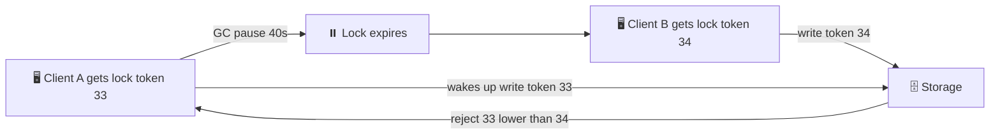

# 15 · Distributed Locks

> [!info] Topic info
> **Subject:** System Design · **Chapter:** Distributed Systems · **Priority:** ⚡ Medium · **Status:** ✅ done · **Last reviewed:** 2026-11-19
>
> [← Back to Distributed Systems](README.md) · [Interview questions →](questions/distributed-systems-qa.md)

> [!abstract] In one line
> A **distributed lock** makes sure only **one process across many machines** works on a resource at a time — usually a **key with a TTL** in Redis, or a **lease** in etcd/ZooKeeper, protected by **fencing tokens**.

---

## 1. The problem

Our app lets users claim a unique vanity URL. Two requests for `/bharat` land on two different servers at the same time. A normal in-process mutex doesn't help — they're different machines.

We need a lock that **all servers** can see.

---

## 2. Two reasons to lock

| Purpose | If the lock fails… | Example |
|---|---|---|
| **Efficiency** | Some work is done twice — annoying but OK | Avoid two servers rebuilding the same cache |
| **Correctness** | Data gets corrupted | Two writers updating one account balance |

This decides how strong your lock must be. Redis is fine for efficiency; for correctness you need consensus + fencing.

---

## 3. Redis lock — SET NX + TTL

```
SET lock:vanity:bharat <random-id> NX PX 30000
```

- `NX` — only set if it **doesn't exist** (that's the "acquire").
- `PX 30000` — auto-expire after **30 s**, so a crashed holder doesn't block forever.
- `<random-id>` — so you only **release your own** lock: delete only if the value still matches (done atomically in a small Lua script).

**✅ Pros:** fast (~1 ms), simple, you already run Redis.
**❌ Cons:** single Redis node = SPOF; async replication means a failover can **lose** the lock; TTL can expire while the holder is still working.

### Redlock and the debate
**Redlock** grabs the lock on a majority of **5 independent Redis nodes** (3 of 5) within a time limit.

Martin Kleppmann argued it's **unsafe for correctness**: it depends on clocks and bounded pauses, and a GC pause can make a client keep working after its lock expired. Redis's author replied that it's fine under its stated assumptions.

> [!note] Interview-safe position
> "Redlock is OK for efficiency locks. For correctness I'd use etcd or ZooKeeper with fencing tokens, because no lock based purely on timeouts can stop a paused client."

---

## 4. The paused-client problem and fencing tokens



The lock service hands out an **increasing token** with every grant. The **storage** checks it and rejects stale ones. Without this, A's late write would silently overwrite B's. → See [Handling Failures](05-handling-failures.md).

---

## 5. ZooKeeper / etcd locks

- Backed by [consensus](11-consensus.md) → the lock **survives node failures** without being lost.
- Lock tied to a **session / lease**; if the client dies, it's released automatically.
- Give you a natural fencing token: ZooKeeper's **zxid / znode version**, etcd's **revision** number.
- ZooKeeper recipe: create **ephemeral sequential** node, lowest number holds the lock, others watch the one before them.

**Trade-off:** slower (a few ms, quorum write) and one more system to run.

> [!tip] 🎤 Say it like this
> "First I ask if the lock is for efficiency or correctness. For efficiency, Redis SET NX with a TTL and a random value is enough. For correctness, I use etcd or ZooKeeper, which are consensus-backed, and I pass the lock's fencing token to the storage so a client that paused and lost its lock can't overwrite newer data."

> [!failure] Interview traps
> - Releasing a lock with plain `DEL` — you may delete **someone else's** lock after yours expired.
> - No TTL → a crashed client holds the lock **forever**.
> - Believing a TTL makes a lock safe — a paused client can outlive it. Need **fencing**.
> - Using a lock when a simpler tool works: a **unique DB constraint** or **conditional update** (`UPDATE … WHERE version = 7`) often removes the need for a lock entirely.

---

## Summary

| Option | Good for | Watch out |
|---|---|---|
| **Redis SET NX PX** | Efficiency locks, fast | Lost on failover, no fencing |
| **Redlock** | Slightly safer Redis | Clock/pause assumptions — debated |
| **etcd / ZooKeeper** | Correctness locks | Slower, extra infra |
| **DB constraint / CAS** | Single-row conflicts | Only within one DB |

> [!success] Key takeaway
> Locks over a network are **leases**, not true locks. For correctness, pair a consensus-backed lock with **fencing tokens checked by storage**.
