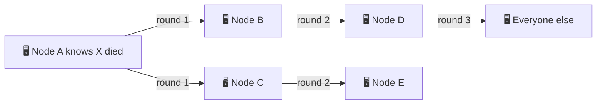

# 16 · Gossip Protocol

> [!info] Topic info
> **Subject:** System Design · **Chapter:** Distributed Systems · **Priority:** 💤 Low · **Status:** ✅ done · **Last reviewed:** 2026-11-19
>
> [← Back to Distributed Systems](README.md) · [Interview questions →](questions/distributed-systems-qa.md)

> [!abstract] In one line
> In a **gossip protocol**, each node periodically shares what it knows with **a few random peers**, so information spreads through the whole cluster like a **rumor** — fast, decentralized, and fault-tolerant.

---

## 1. The problem

A 1,000-node Cassandra cluster needs every node to know who's alive and who owns which data. A central monitor is a SPOF. Every node pinging every other node is ~**1 million** messages per round.

Gossip spreads the same info with **a handful of messages per node per second**.

---

## 2. How it works

Every ~1 second, each node:
1. Picks **1–3 random** peers.
2. Sends its view: "here's who I know about, with their latest heartbeat counter / version".
3. Both sides **merge**, keeping the newer info for each node.

The number of informed nodes roughly **doubles each round**, so news reaches N nodes in about **log₂(N)** rounds — ~10 rounds for 1,000 nodes.

---

## 3. Where it's used

- **Membership + failure detection** — Cassandra, Consul (Serf/SWIM), Redis Cluster.
- **Spreading metadata** — ring/token ownership in Cassandra and Dynamo-style stores.
- **Anti-entropy** — replicas compare data (often with [Merkle trees](../data-structures/10-merkle-trees.md)) and fix differences.

> [!tip] 🎤 Say it like this
> "With gossip, every node regularly talks to a few random peers and they swap what they know. Information spreads exponentially, reaching everyone in about log N rounds, with no central coordinator. It's used for membership and failure detection in Cassandra and Consul. The trade-off is it's eventually consistent — nodes briefly have different views."

**✅ Pros:** no SPOF, scales to thousands of nodes, tolerates lost messages.
**❌ Cons:** **eventually** consistent views; seconds of delay; hard to debug.

> [!failure] Interview traps
> - Using gossip for things that need **agreement** (who's the leader, lock owner) — that needs [consensus](11-consensus.md).

---

## Summary

- Random peer-to-peer sharing → spreads in **O(log N)** rounds.
- Great for membership, failure detection, metadata. Not for strong agreement.

> [!success] Key takeaway
> Gossip = scalable, eventually consistent "everyone finds out soon". Consensus = slower "everyone agrees now".
