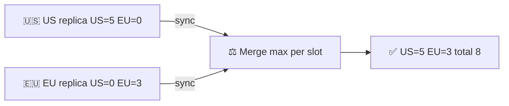

# 17 · CRDTs

> [!info] Topic info
> **Subject:** System Design · **Chapter:** Distributed Systems · **Priority:** ⚡ Medium · **Status:** ✅ done · **Last reviewed:** 2026-11-19
>
> [← Back to Distributed Systems](README.md) · [Interview questions →](questions/distributed-systems-qa.md)

> [!abstract] In one line
> A **CRDT (Conflict-free Replicated Data Type)** is a data structure designed so replicas can **update independently** and **always merge to the same result** — no coordination, no conflicts.

---

## 1. The problem

Our app's like counter runs in 3 regions, AP style (see [CAP](../core-concepts/07-cap-theorem.md)). During a partition, US gets +5 likes, EU gets +3. When they reconnect, a naive "last write wins" keeps only one side's number — **likes are lost**.

We want a counter (and later, lists and text) that **merges correctly by design**.

---

## 2. The core idea

The merge function must be:
- **Commutative** — order doesn't matter (A+B = B+A).
- **Associative** — grouping doesn't matter.
- **Idempotent** — merging the same update twice changes nothing.

If merge has these properties, replicas can sync in **any order, any number of times**, and still end up identical. That's called **strong eventual consistency**.

---

## 3. Common CRDTs

| CRDT | How it works | Use |
|---|---|---|
| **G-Counter** (grow-only) | One counter **per replica**; total = sum; merge = max per slot | Views, likes |
| **PN-Counter** | Two G-Counters: increments and decrements | Likes with unlike |
| **G-Set** | Add-only set; merge = union | Tags seen |
| **OR-Set** (observed-remove) | Each add gets a unique tag; remove deletes only tags it saw | Shopping cart, group members |
| **LWW-Register** | Keep value with the highest timestamp | Profile field |
| **Sequence CRDT** (RGA, Yjs, Automerge) | Each character gets a unique, ordered ID | Collaborative text |

> [!example] OR-Set in a cart
> You add milk on your phone; on your laptop (offline) you remove the milk you saw earlier and add eggs. Merge: the remove only kills the milk-tag it **saw**, so a **new** concurrent add of milk survives. "Add wins" — no lost items.

---

## 4. Where they're used

- **Collaborative / local-first apps** — Figma-style multiplayer, Apple Notes, Linear, apps built on **Yjs** or **Automerge**.
- **Databases** — Redis Enterprise active-active, Riak, Azure Cosmos DB multi-region.
- Comparison with the other approach to collaborative editing → [Operational Transformation](18-operational-transformation.md).

> [!tip] 🎤 Say it like this
> "A CRDT is a data type whose merge is commutative, associative and idempotent, so replicas can accept writes independently, even offline, and always converge to the same state. A like counter is a G-Counter: each region counts its own likes and the total is the sum. For collaborative text, sequence CRDTs like Yjs give each character a unique ID so concurrent inserts merge cleanly."

**✅ Pros:** no coordination, works offline, multi-region writes, always converges.
**❌ Cons:** metadata overhead (tombstones, IDs can grow large); only certain operations fit; can't enforce global rules like "balance ≥ 0" or "username unique".

> [!failure] Interview traps
> - Saying CRDTs give **strong** consistency — they give **eventual** (strong *eventual*).
> - Using a CRDT for invariants that need coordination: bank balances, inventory that must not go negative.
> - Forgetting **tombstones** — deleted items leave markers that need garbage collection.

---

## Summary

- Merge is **commutative + associative + idempotent** → replicas always converge.
- Counters, sets, registers, sequences; G-Counter and OR-Set are the classic examples.
- Great for multi-region and offline/collaborative apps; bad for global invariants.

> [!success] Key takeaway
> CRDTs remove conflicts **by design** — pick them when availability and offline writes matter more than strict rules.
