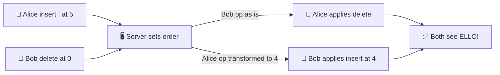

# 18 · Operational Transformation

> [!info] Topic info
> **Subject:** System Design · **Chapter:** Distributed Systems · **Priority:** ⚡ Medium · **Status:** ✅ done · **Last reviewed:** 2026-11-19
>
> [← Back to Distributed Systems](README.md) · [Interview questions →](questions/distributed-systems-qa.md)

> [!abstract] In one line
> **Operational Transformation (OT)** lets many users edit the same document live by **adjusting (transforming) each edit** against concurrent edits, usually through a **central server** that sets the order — the approach behind **Google Docs**.

---

## 1. The problem

Alice and Bob both open the doc `"HELLO"`.
- Alice inserts `"!"` at position 5 → `"HELLO!"`
- At the same time, Bob deletes position 0 (`H`) → `"ELLO"`

If Bob simply applies Alice's "insert at 5" to `"ELLO"`, the `!` lands at the wrong place (or past the end). The two screens **diverge**.

---

## 2. How OT fixes it

When an operation arrives that was made **concurrently** with one already applied, **transform** it to account for that change.

Bob already deleted 1 char before position 5 → Alice's insert shifts to **position 4**. Now both get `"ELLO!"`. ✅

### Central server
In practice (Google Docs, Jupiter-style OT), a **server** decides the one true order of operations. Each client sends ops tagged with the version it was based on; the server transforms them against anything newer and broadcasts. This keeps the transform logic manageable.

---

## 3. CRDT vs OT — the comparison interviewers want

| | **OT** | **CRDT** |
|---|---|---|
| **Idea** | Transform ops against concurrent ops | Data type merges automatically |
| **Needs a central server?** | Usually yes — server orders ops | No — peer-to-peer works |
| **Offline editing** | Hard — long divergence = complex transforms | Natural — merge whenever you reconnect |
| **Metadata** | Small — ops are just positions | Larger — unique IDs per char, tombstones |
| **Correctness** | Transform functions are notoriously tricky | Proven by math properties of merge |
| **Used by** | Google Docs, Etherpad, older collaborative editors | Figma-style multiplayer (inspired), Yjs, Automerge, Apple Notes, Linear |

> [!note] Figma's approach
> Figma isn't a pure text CRDT — it uses a **central server** plus CRDT-like ideas (last-writer-wins per object property). The lesson: real products **mix** approaches.

### Which to choose
- **Central server, always online, text docs** → OT is proven (Google Docs).
- **Offline-first, peer-to-peer, or multi-region** → [CRDTs](17-crdts.md).
- **New projects today** → many pick CRDT libraries (Yjs, Automerge) because they're ready-made.

> [!tip] 🎤 Say it like this
> "For collaborative editing there are two main approaches. OT, used by Google Docs, sends each edit to a central server that orders them and transforms concurrent edits so positions still line up. CRDTs give every element a unique ID so edits merge automatically without a central server, which makes offline and peer-to-peer easy, at the cost of more metadata. If I need offline support I'd pick a CRDT library like Yjs."

> [!failure] Interview traps
> - Saying OT works fine **peer-to-peer** — decentralized OT is very hard to get right; almost everyone uses a server.
> - Forgetting the rest of the system: **WebSockets** for live updates ([WebSockets](../communication-patterns/03-websockets.md)), presence/cursors, and snapshotting the op log.
> - Thinking last-write-wins is enough for text — it would drop whole edits.

---

## Summary

- OT = **transform** concurrent ops so they still apply correctly; needs a **server** to order ops.
- CRDT = **merge-by-design** data; works offline and peer-to-peer; heavier metadata.
- Google Docs → OT. Yjs / Automerge / local-first apps → CRDT.

> [!success] Key takeaway
> Online + central server → OT is fine. Offline or decentralized → CRDT. Either way, the server pushes changes live over WebSockets.
