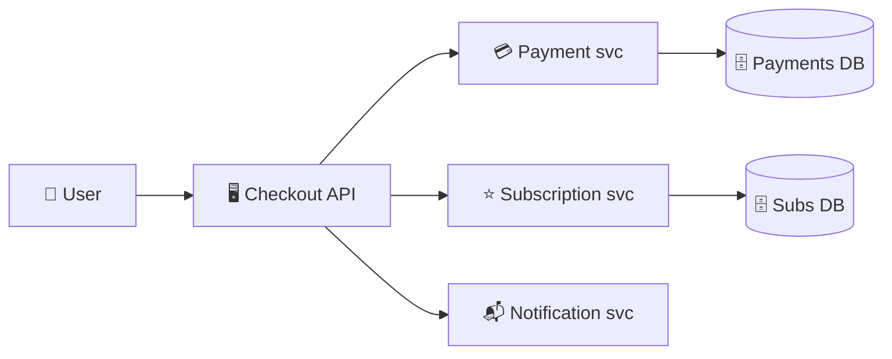

# 01 · The Distributed Transactions Problem

> [!info] Topic info
> **Subject:** System Design · **Chapter:** Distributed Transactions · **Priority:** ⚡ Medium · **Status:** ✅ done · **Last reviewed:** 2026-11-19
>
> [← Back to Distributed Transactions](README.md) · [Interview questions →](questions/distributed-transactions-qa.md)

> [!abstract] In one line
> A **distributed transaction** is one business action that must change data in **several services or databases** and still be **all-or-nothing** — which a single-DB `BEGIN … COMMIT` can no longer give us.

---

## 1. The problem

Our social media app sells **Premium** for $5/month. Buying it touches three services, each with its own database:

1. **Payment service** — charge the card.
2. **Subscription service** — mark the user as Premium.
3. **Notification service** — send a "Welcome to Premium" email.

If the card is charged but the subscription write fails, the user paid and got nothing. That's the bug we must prevent.

---

## 2. Why one database made this easy

In a monolith with one DB, we wrap everything in one **ACID transaction** (recap in [Reliability](../core-concepts/03-reliability.md) and [ACID Transactions](../databases/03-acid-transactions.md)). The DB guarantees all writes commit together or none do.

With [microservices](../architectural-patterns/03-microservices.md), each service **owns its own DB**. There is no single DB that can say "commit all of it". Each service can only commit its own part.

> [!note] Why not just share one DB?
> Sharing one database across services couples them tightly — one schema change breaks everyone. "Database per service" is the norm, so we need another way.

---

## 3. What can go wrong

The network between services is unreliable (see [Challenges of Distribution](../distributed-systems/01-challenges-of-distribution.md)):

- **Partial failure** — payment succeeds, subscription service is down.
- **Crash mid-way** — the checkout API dies after step 1, before step 2.
- **Timeout ambiguity** — we didn't get a reply. Did the charge happen or not? We can't tell.
- **Retries cause duplicates** — retrying a charge might charge twice (needs [idempotency](../api-fundamentals/03-idempotency.md)).

---

## 4. The two families of solutions

| Approach | Idea | Consistency | Used for |
|---|---|---|---|
| **Atomic commit** ([2PC](02-two-phase-commit.md), [3PC](03-three-phase-commit.md)) | A coordinator makes everyone commit or abort together | Strong, all-or-nothing | Databases, few participants, same data center |
| **Saga** ([Saga](04-saga-pattern.md)) | Run local steps one by one, undo with compensations on failure | Eventual | Microservices, long business flows |

Supporting both: the **[Outbox pattern](05-outbox-pattern.md)** — reliably save data and publish an event together, so steps never get lost.

> [!tip] 🎤 Say it like this
> "Once each service owns its own database, I can't use a single ACID transaction across them. I either use an atomic commit protocol like 2PC, which is strongly consistent but blocking and slow, or more commonly a saga — a chain of local transactions with compensating actions — combined with the outbox pattern so events are never lost."

> [!failure] Interview traps
> - Saying "just use a transaction" across microservices — there is no shared DB to run it on.
> - Ignoring the **timeout** case: "no reply" doesn't mean "failed".
> - Reaching for 2PC by default — most microservice systems use sagas.

---

## Summary

- One business action, many databases → no single ACID transaction.
- Failures: partial success, crash mid-way, timeouts, duplicate retries.
- Options: **2PC/3PC** (strong, blocking) or **Saga** (eventual, scalable), plus **Outbox** for reliable events.

> [!success] Key takeaway
> First try to keep the transaction inside **one service**. If you can't, prefer a **saga + outbox** over 2PC in microservices.
