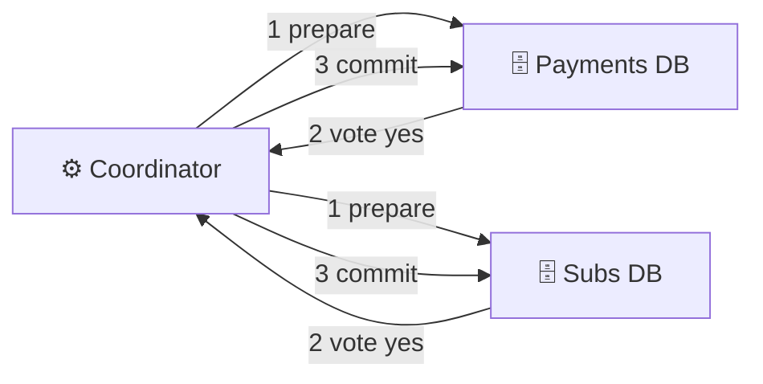

# 02 · Two-Phase Commit (2PC)

> [!info] Topic info
> **Subject:** System Design · **Chapter:** Distributed Transactions · **Priority:** ⚡ Medium · **Status:** ✅ done · **Last reviewed:** 2026-11-19
>
> [← Back to Distributed Transactions](README.md) · [Interview questions →](questions/distributed-transactions-qa.md)

> [!abstract] In one line
> **Two-phase commit** uses a **coordinator** that first asks every participant to **prepare** (promise they can commit), and only if **all vote yes** tells them to **commit** — giving all-or-nothing across databases, at the cost of **blocking**.

---

## 1. The problem

Premium checkout must write to the **Payments DB** and the **Subscriptions DB** ([the problem](01-distributed-transactions-problem.md)). We want both writes to commit together or neither, like a normal ACID transaction.

2PC is the classic answer: add a **coordinator** that runs a vote.

---

## 2. How it works

**Phase 1 — Prepare (voting)**
- Coordinator sends `PREPARE` to every participant.
- Each participant does the work, writes it to its log, **locks the rows**, and replies `YES` (I can commit for sure) or `NO`.
- After saying `YES`, a participant can't change its mind — it must wait for the decision.

**Phase 2 — Commit / Abort (decision)**
- All `YES` → coordinator logs `COMMIT` and tells everyone to commit.
- Any `NO` or timeout → coordinator tells everyone to `ABORT`.
- Participants apply the decision, release locks, and ack.

> [!example] Analogy — a wedding
> The officiant asks both people "do you?" (prepare). Only after both say "I do" are they declared married (commit). If either says no, nobody gets married.

---

## 3. The big problem — blocking

Imagine both databases voted `YES` and are holding locks. Now the **coordinator crashes** before sending the decision.

- Participants can't commit — maybe someone else voted `NO`.
- They can't abort — maybe the coordinator already told another one to commit.
- So they **wait, holding locks**, until the coordinator comes back. Other requests touching those rows are stuck.

That's why 2PC is called a **blocking protocol**. The coordinator is a [single point of failure](../core-concepts/04-single-point-of-failure.md).

> [!warning] Other costs
> - **Latency** — 2 round trips, plus disk writes, while locks are held.
> - **Throughput** — locked rows block other transactions; one slow participant slows all.
> - **Availability** — every participant must be up. 3 services at 99.9% → about 99.7% for the whole thing.

---

## 4. Where 2PC is actually used

- **Inside databases** — distributed SQL databases (e.g. Spanner, CockroachDB) use 2PC between their own shards, with the coordinator made highly available through [consensus](../distributed-systems/11-consensus.md) so it doesn't block forever.
- **XA transactions** — a standard to run 2PC across e.g. a database and a message broker. Works, but slow and rarely loved.
- **Not** across microservices owned by different teams — use a [saga](04-saga-pattern.md) there.

> [!tip] 🎤 Say it like this
> "2PC has a coordinator ask every participant to prepare and vote. If everyone votes yes it commits, otherwise it aborts. It gives strong atomicity, but it's blocking — if the coordinator dies after the votes, participants sit holding locks. So I'd use it inside a database or over a small set of resources, not across microservices."

**✅ Pros**
- True all-or-nothing, strong consistency.
- Application code stays simple — looks like one transaction.

**❌ Cons**
- Blocking if the coordinator fails.
- Slow, holds locks across network calls.
- Every participant must support prepare and be available.

> [!failure] Interview traps
> - Saying 2PC "solves" distributed consensus — it doesn't tolerate coordinator failure on its own.
> - Forgetting that participants **hold locks** while waiting.
> - Suggesting 2PC across third-party APIs (like Stripe) — they don't support a prepare phase.

---

## Summary

| Phase | What happens |
|---|---|
| **Prepare** | Everyone does the work, locks, and votes yes/no |
| **Commit/Abort** | Coordinator decides; all yes → commit, else abort |
| **Weak spot** | Coordinator crash after votes → participants blocked |

> [!success] Key takeaway
> 2PC = strong but **blocking and slow**. Great inside a database, a poor fit for microservices.
