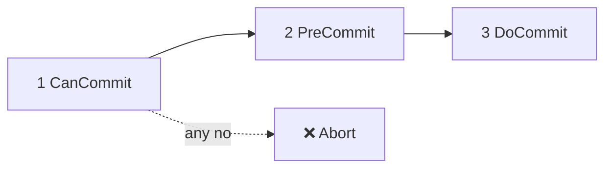

# 03 · Three-Phase Commit (3PC)

> [!info] Topic info
> **Subject:** System Design · **Chapter:** Distributed Transactions · **Priority:** 💤 Low · **Status:** ✅ done · **Last reviewed:** 2026-11-19
>
> [← Back to Distributed Transactions](README.md) · [Interview questions →](questions/distributed-transactions-qa.md)

> [!abstract] In one line
> **Three-phase commit** adds a **pre-commit** step to 2PC so participants can **decide on their own** when the coordinator dies — removing blocking, but only if the network **never partitions**, which is why it's **rarely used**.

---

## 1. The problem

In [2PC](02-two-phase-commit.md), if the coordinator crashes after everyone votes `YES`, participants are stuck holding locks. They don't know if the decision was commit or abort.

3PC tries to fix this by making sure participants always know enough to finish without the coordinator.

---

## 2. How it works

1. **CanCommit** — coordinator asks "can you commit?" Participants vote yes/no (no locks yet beyond checks).
2. **PreCommit** — if all said yes, coordinator sends `PRECOMMIT`. Participants prepare and ack. Now everyone knows **all voted yes**.
3. **DoCommit** — coordinator sends `COMMIT`.

The key rule: if the coordinator dies and a participant **got PreCommit**, it knows everyone voted yes, so after a **timeout** it commits. If it **didn't** get PreCommit, it safely aborts.

---

## 3. Why it's rarely used

- **Breaks under network partitions.** One group got PreCommit and commits on timeout; the other group didn't and aborts. Data is now inconsistent — worse than blocking. (See [Network Partitions](../distributed-systems/02-network-partitions.md).)
- **Relies on timeouts** — it assumes a slow node is a dead node, which isn't true on real networks.
- **Even slower** — 3 round trips instead of 2.

Real systems that need non-blocking atomic commit run 2PC with a coordinator replicated through **consensus** ([Paxos](../distributed-systems/12-paxos.md) / [Raft](../distributed-systems/13-raft.md)) instead.

> [!tip] 🎤 Say it like this
> "3PC adds a pre-commit phase so participants can finish without the coordinator, which removes 2PC's blocking. But it assumes there are no network partitions — during a split, some nodes commit and others abort. That's why in practice people use 2PC with a consensus-replicated coordinator, or sagas."

> [!failure] Interview traps
> - Claiming 3PC "solves" 2PC's problems in real networks — it doesn't handle partitions.
> - Not knowing what the extra phase is for (it tells everyone that **all voted yes**).

---

## Summary

- 3PC = CanCommit → PreCommit → DoCommit.
- Non-blocking on node crashes, **unsafe on partitions**, slower.
- Practically replaced by 2PC + consensus, or sagas.

> [!success] Key takeaway
> Know **why** it exists and **why** nobody uses it — that's the whole interview answer.
