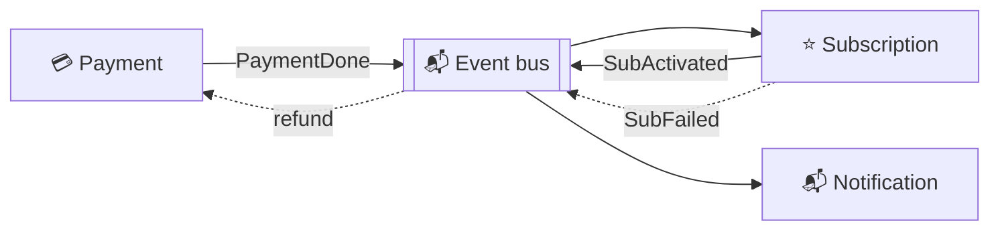
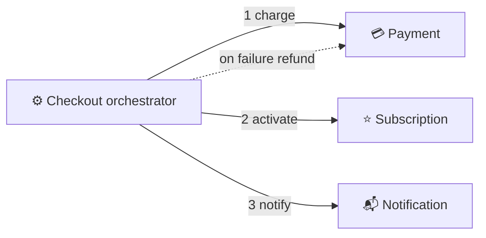

# 04 · Saga Pattern

> [!info] Topic info
> **Subject:** System Design · **Chapter:** Distributed Transactions · **Priority:** 🔥 High · **Status:** ✅ done · **Last reviewed:** 2026-11-19
>
> [← Back to Distributed Transactions](README.md) · [Interview questions →](questions/distributed-transactions-qa.md)

> [!abstract] In one line
> A **saga** splits one big distributed transaction into a **sequence of local transactions**, one per service. If a step fails, earlier steps are undone with **compensating actions** — giving **eventual consistency** without global locks.

---

## 1. The problem

Premium checkout spans Payment, Subscription and Notification services ([the problem](01-distributed-transactions-problem.md)). [2PC](02-two-phase-commit.md) would lock rows across all three and block if the coordinator dies.

We'd rather let each service commit **its own** step quickly, and have a plan to **undo** if something later fails.

---

## 2. How it works

Each step is a normal local ACID transaction. Each step has a matching **compensation** — a new action that semantically undoes it.

| Step | Action | Compensation |
|---|---|---|
| **1. Payment** | Charge $5 | Refund $5 |
| **2. Subscription** | Activate Premium | Deactivate Premium |
| **3. Notification** | Send welcome email | *(none — can't unsend)* |

If step 2 fails, we run the compensations for completed steps **in reverse**: refund the $5.

> [!important] Compensation ≠ rollback
> A rollback erases a change as if it never happened. A compensation is a **new forward action** (a refund), and the original charge stays in history. Some things, like a sent email, can't be compensated — put them **last**.

> [!note] Pivot step
> Order steps so the ones that can fail come first, and the irreversible ones come after the "point of no return". Once the pivot step succeeds, the saga only moves forward (retrying until done).

---

## 3. Choreography vs orchestration

There are two ways to drive the steps.

**Choreography** — no boss. Each service listens for events and reacts.

**Orchestration** — a central **orchestrator** tells each service what to do and tracks the state.

| | **Choreography** | **Orchestration** |
|---|---|---|
| **Control** | Spread across services via events | One orchestrator owns the flow |
| **Coupling** | Loose — services only know events | Services coupled to orchestrator |
| **Visibility** | Hard to see the whole flow | Flow in one place, easy to debug |
| **Best for** | 2–4 simple steps | Many steps, branching, timeouts |
| **Risk** | Cyclic event chains, "who handles what?" | Orchestrator becomes too smart |

Orchestrators are often built with workflow engines like **Temporal**, **AWS Step Functions** or **Camunda**, which persist saga state so it survives crashes.

---

## 4. The lack of isolation

A saga has **A, C, D but not I** of ACID. Between steps, other requests can see half-done data.

Example: payment succeeded, Premium activated, then a later step fails and we deactivate. In between, the user saw Premium badges for 2 seconds, or a feed service already gave them Premium features.

**How to deal with it:**
- **Semantic lock / pending state** — mark records as `PENDING` (e.g. subscription `status = PENDING_PAYMENT`). Other code treats pending as "not yet". Final step flips it to `ACTIVE`.
- **Reorder steps** — do the risky, checkable steps first, user-visible ones last.
- **Commutative updates** — design updates that work in any order (e.g. `balance += 5` instead of `balance = 105`).
- **Re-read values** — before acting, check the record hasn't changed since the saga started (version check).

---

## 5. Making sagas reliable

- **Idempotent steps** — messages are delivered at-least-once, so "charge" may arrive twice. Use an idempotency key (the saga ID) so the second call is a no-op. See [Idempotency](../api-fundamentals/03-idempotency.md).
- **Idempotent compensations** — "refund" can also be retried. They must **never fail permanently**; retry them until they succeed (or alert a human).
- **Reliable events** — each step must save its state and publish its event atomically → [Outbox pattern](05-outbox-pattern.md).
- **Persist saga state** — the orchestrator stores "step 2 done" so a restart resumes, not restarts.
- **Timeouts** — if a step never replies, decide: retry, or compensate.

> [!tip] 🎤 Say it like this
> "I'd model checkout as a saga: each service commits its own local transaction, and if a later step fails, we run compensating actions in reverse — like refunding the payment. For a few steps I'd use choreography with events; for longer flows an orchestrator like Temporal. Since sagas aren't isolated, I use pending states, and every step and compensation is idempotent because messages can be redelivered."

**✅ Pros**
- No global locks, each service stays independent and available.
- Scales well; works for long-running flows (minutes or days).
- Works with external APIs (Stripe refunds = compensation).

**❌ Cons**
- Only eventual consistency; no isolation.
- Compensation logic for every step = more code and testing.
- Harder to debug, especially choreography.

> [!failure] Interview traps
> - Calling compensation a "rollback" — it's a new action, and some actions can't be undone.
> - Forgetting isolation: other users can see intermediate state.
> - Non-idempotent steps → double charges on retry.
> - Choreography with 10 services → nobody can follow the flow. Switch to orchestration.

---

## Summary

| Concept | What it fixes |
|---|---|
| **Local transactions per step** | No global locks or coordinator blocking |
| **Compensating actions** | Undo completed steps when a later one fails |
| **Choreography / Orchestration** | Who drives the flow — events vs a central brain |
| **Pending states** | Hide half-done data (lack of isolation) |
| **Idempotency + outbox** | Safe retries, no lost events |

> [!success] Key takeaway
> Saga is the **default answer** for transactions across microservices: local commits + compensations + idempotency, accepting eventual consistency.
