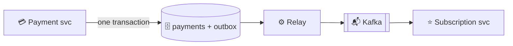
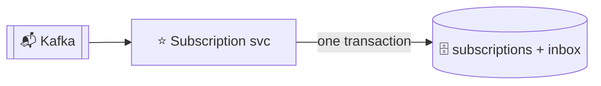

# 05 · Outbox Pattern

> [!info] Topic info
> **Subject:** System Design · **Chapter:** Distributed Transactions · **Priority:** ⚡ Medium · **Status:** ✅ done · **Last reviewed:** 2026-11-19
>
> [← Back to Distributed Transactions](README.md) · [Interview questions →](questions/distributed-transactions-qa.md)

> [!abstract] In one line
> The **transactional outbox** saves a business change and its **event** in the **same local transaction** (event goes to an `outbox` table), then a **relay** publishes it — so data and events never get out of sync.

---

## 1. The problem (recap)

Already covered in [Reliability — section 7](../core-concepts/03-reliability.md): the **dual-write problem**. Saving to the DB and publishing to a queue are two separate writes. A crash between them leaves the DB and the event stream out of sync.

In a [saga](04-saga-pattern.md) this is fatal: Payment commits the charge but never publishes `PaymentDone`, so the subscription is never activated.

---

## 2. How it works (recap)

- `INSERT payment` + `INSERT outbox(event)` in **one** transaction → both or neither.
- The relay publishes outbox rows. It may publish twice (**at-least-once**), so consumers must be idempotent.

Below is what the reliability note doesn't cover.

---

## 3. Polling vs CDC — how the relay reads the outbox

| | **Polling publisher** | **CDC (log tailing)** |
|---|---|---|
| **How** | `SELECT … WHERE published = false` every N ms | Reads the DB's change log (Postgres WAL, MySQL binlog) |
| **Tooling** | A simple background job | **Debezium** → Kafka |
| **DB load** | Extra queries, grows with traffic | Very low |
| **Latency** | Up to the poll interval (e.g. 500 ms) | Near real time |
| **Complexity** | Easy to build | Extra infra to run and monitor |

Start with polling for small systems; move to CDC at scale. More on CDC in [Change Data Capture](../big-data/02-change-data-capture.md).

---

## 4. Ordering

Events for the same entity must arrive in order — `SubActivated` before `SubCancelled`.

- Give outbox rows an increasing **sequence ID** and publish in that order.
- Use the **entity ID as the Kafka partition key**, so all events of one user go to one partition (ordered).
- With multiple relay instances, make sure only one handles a given partition/shard (e.g. leader election or row locking with `SELECT … FOR UPDATE SKIP LOCKED`).

---

## 5. Cleaning up the outbox table

The outbox grows forever if you leave it alone — millions of rows a day in a busy app.

- **Delete** rows after they're published, or mark `published_at` and delete in a nightly batch.
- With CDC, you can delete the row **right after inserting** it in the same transaction — the insert still lands in the log and Debezium sees it.
- Or partition the table by day and drop old partitions (fast, no big deletes).

---

## 6. Inbox pattern — the consumer side

The outbox guarantees the event is sent **at least once**. The consumer must handle duplicates.

**Inbox pattern:** the consumer stores each processed `event_id` in an `inbox` table, **in the same transaction** as its business change.

- Event ID already in inbox → skip, just ack.
- New → apply change + insert event ID, commit, then ack.

Outbox + inbox together give **effectively-once** processing. See [Delivery Semantics](../communication-patterns/09-delivery-semantics.md).

> [!tip] 🎤 Say it like this
> "To avoid the dual-write problem, I write the event into an outbox table in the same transaction as the data. A relay — polling, or CDC with Debezium at scale — publishes it to Kafka, keyed by entity ID for ordering. Since delivery is at-least-once, consumers use an inbox table of processed event IDs to stay idempotent, and old outbox rows are cleaned up regularly."

> [!failure] Interview traps
> - Publishing to Kafka **inside** the DB transaction — the transaction can still roll back after the message is sent.
> - Assuming the outbox gives exactly-once — it's at-least-once; you need idempotent consumers.
> - Forgetting to clean up the table, or forgetting ordering with multiple relays.

---

## Summary

| Piece | What it fixes |
|---|---|
| **Outbox table** | Data + event saved atomically |
| **Polling / CDC relay** | Gets events out; CDC = low load, low latency |
| **Partition key + sequence** | Per-entity ordering |
| **Cleanup** | Table doesn't grow forever |
| **Inbox table** | Duplicate events processed once |

> [!success] Key takeaway
> Outbox on the producer, inbox (or idempotency) on the consumer — that's how every saga step stays reliable.
