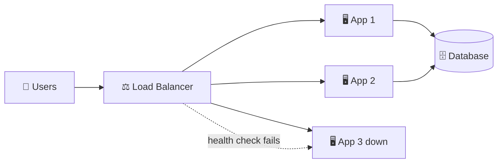
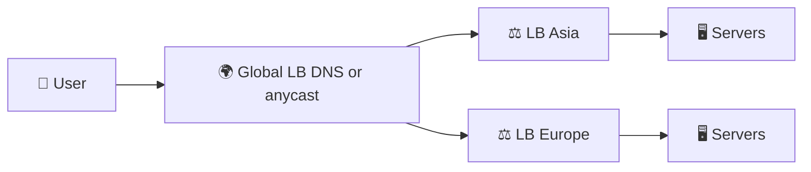

# 01 · Load Balancers

> [!info] Topic info
> **Subject:** System Design · **Chapter:** Load Balancing · **Priority:** 🔥 High · **Status:** ✅ done · **Last reviewed:** 2026-11-19
>
> [← Back to Load Balancing](README.md) · [Interview questions →](questions/load-balancing-qa.md)

> [!abstract] In one line
> A **load balancer (LB)** sits in front of a group of servers, gives clients **one address**, and **spreads requests** across only the **healthy** servers.

---

## 1. The problem

Our social media app grew from 1 server to 5 app servers, because one box can't handle 20,000 req/s.
But users only know one address: `api.ourapp.com`. Who decides which of the 5 servers gets each request? And what if server 3 crashes?

We need something in the middle that hides the servers, shares the work, and skips the broken ones. That's the load balancer.

---

## 2. How it works

Clients talk to the LB. The LB picks a healthy server, forwards the request, and sends the response back.
The servers can be added or removed anytime — clients never notice. This is what makes [horizontal scaling](../core-concepts/01-scalability.md) possible.

What a LB gives you:

- **Scalability** — add servers behind it to handle more traffic.
- **Availability** — a dead server is removed from rotation automatically.
- **One entry point** — a good place for TLS termination, rate limits, and logging.
- **Zero-downtime deploys** — drain one server, update it, put it back.

> [!note] TLS termination
> The LB decrypts HTTPS once, so app servers receive plain HTTP inside the private network. This saves CPU on every app server and keeps certificates in one place.

---

## 3. L4 vs L7 load balancers

The "L" is the layer in the [OSI model](../networking/01-osi-model.md). It decides **how much of the request the LB can see**.

| | **L4 (transport)** | **L7 (application)** |
|---|---|---|
| **Looks at** | IP + port only (TCP/UDP) | Full HTTP request: URL, headers, cookies |
| **Can route by** | Connection | Path, host, header, cookie (`/api` → API servers, `/images` → image servers) |
| **Speed** | Very fast, low CPU | Slower — must parse every request |
| **TLS** | Usually passes it through | Usually terminates it |
| **Examples** | AWS NLB, LVS | AWS ALB, Nginx, HAProxy, Envoy |

Real systems often use both: an L4 LB at the edge for raw speed, then L7 LBs behind it for smart routing.

> [!tip] 🎤 Say it like this
> "An L4 load balancer only sees IPs and ports, so it's very fast but can't make content-based decisions. An L7 load balancer reads the HTTP request, so it can route by URL or header, terminate TLS, and do retries — at the cost of more CPU. I'd usually put an L7 LB in front of web services."

---

## 4. Health checks

The LB pings each server regularly, for example `GET /health` every 5 s. After ~3 failures the server is taken out; after ~2 successes it comes back.
This is covered in detail in [Availability → health checks](../core-concepts/02-availability.md).

- **Active checks** — LB sends probes on a timer.
- **Passive checks** — LB watches real traffic; too many errors or timeouts → remove the server.

> [!warning] Shallow vs deep checks
> A check that just returns `200 OK` can pass while the server's database connection is broken. But if `/health` checks the shared database, one DB hiccup marks **every** server unhealthy at once. Check what the server itself owns; be careful with shared dependencies.

---

## 5. Sticky sessions

**Sticky sessions** (session affinity) mean the same user always goes to the same server — usually via a cookie the LB sets.
Needed when the server keeps user state in memory, like a login session or a shopping cart.

**✅ Pros**
- Works with old stateful apps without rewriting them.
- Better local cache hits for that user.

**❌ Cons**
- Uneven load — one server can get stuck with heavy users.
- If that server dies, those users lose their session.
- Harder to scale down or deploy.

> [!important] Better fix
> Make servers **stateless** — keep sessions in Redis or use tokens ([JWT](../api-fundamentals/11-jwt.md)). Then any server can handle any request and stickiness isn't needed.

---

## 6. The LB itself as a SPOF

If all traffic goes through one LB, that LB is a [single point of failure](../core-concepts/04-single-point-of-failure.md).

Common fixes:
- **Active-passive pair** — two LBs share a **floating IP**; if the active one dies, the standby takes over the IP in seconds (VRRP / keepalived).
- **Active-active** — several LBs, with [DNS](03-dns-load-balancing.md) or [anycast](04-anycast-routing.md) spreading traffic across them.
- **Managed cloud LBs** (AWS ELB, GCP LB) are already redundant across zones.

---

## 7. Local vs global load balancing

| | **Local (LLB)** | **Global (GSLB)** |
|---|---|---|
| **Spreads across** | Servers in one data center / region | Data centers or regions |
| **How** | L4 / L7 LB | DNS, anycast |
| **Goal** | Share load, skip dead servers | Send users to nearest healthy region, survive a region outage |

A user in Mumbai → GSLB sends them to the Asia region → the local LB there picks a server.

> [!failure] Interview traps
> - Drawing one LB box and never mentioning it needs redundancy.
> - Saying "use sticky sessions" without mentioning they break even load and failover.
> - Confusing L4 and L7 — L4 can't route by URL path.
> - Forgetting the LB also needs health checks to be useful at all.

---

## Summary

| Idea | What it fixes |
|---|---|
| **Load balancer** | One entry point, work spread across many servers |
| **Health checks** | Dead servers stop getting traffic |
| **L4 vs L7** | Speed vs smart content-based routing |
| **Stateless servers** | No need for sticky sessions |
| **LB pair / GSLB** | LB and region failures don't take you down |

> [!success] Key takeaway
> A load balancer makes many servers look like one. Pick L7 for smart routing, keep servers stateless, and always make the LB itself redundant.
