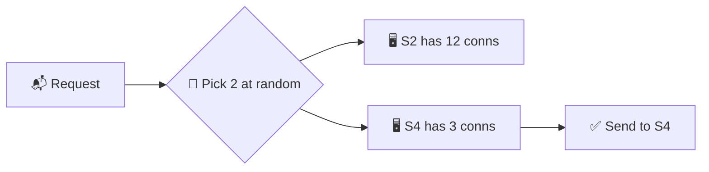

# 02 · Load Balancing Algorithms

> [!info] Topic info
> **Subject:** System Design · **Chapter:** Load Balancing · **Priority:** 🔥 High · **Status:** ✅ done · **Last reviewed:** 2026-11-19
>
> [← Back to Load Balancing](README.md) · [Interview questions →](questions/load-balancing-qa.md)

> [!abstract] In one line
> A **load balancing algorithm** is the rule the LB uses to **pick a server** for each request — either **static** (fixed rotation) or **dynamic** (based on current load).

---

## 1. The problem

Our [load balancer](01-load-balancers.md) has 5 healthy servers. A request arrives — which one gets it?
If we choose badly, one server hits 95% CPU and slows everyone down while another sits at 10%. The algorithm is what keeps load even.

---

## 2. Static algorithms — ignore current load

### Round robin
Send requests in order: 1, 2, 3, 4, 5, 1, 2, … Simple and fair **if** servers are identical and requests cost about the same.

### Weighted round robin
Give stronger servers a bigger share. A server with weight 3 gets 3 requests for every 1 that a weight-1 server gets.
Useful when you mix machine sizes, or for a canary (new version gets weight 1 out of 20 = 5%).

### IP hash
`hash(client IP) % N` → the same client always lands on the same server. Gives stickiness without cookies.

> [!warning] IP hash traps
> - Thousands of users behind one office NAT share one IP → one server gets all of them.
> - With `% N`, adding or removing one server remaps almost every client. Fix: consistent hashing (below).

---

## 3. Dynamic algorithms — look at current load

### Least connections
Send to the server with the **fewest open connections**. Great when requests take very different times — e.g. some API calls take 10 ms and video uploads take 30 s.
**Weighted least connections** divides by server weight.

### Least response time
Send to the server with the **lowest recent latency** (often combined with fewest connections). Naturally avoids a server that's slow because of GC pauses or a noisy neighbour.

### Power of two choices
Pick **2 servers at random**, send to the one with fewer connections. That's it.

It sounds too simple, but it gets very close to "pick the best server" without checking all of them.
It also avoids the **herd problem**: with many LBs all choosing the single "least loaded" server, they all pile onto it at once. Random sampling spreads them out. Nginx and Envoy support it.

---

## 4. Consistent hashing

When the **same key must go to the same server** — cache servers, chat rooms, user shards — use [consistent hashing](../core-concepts/06-consistent-hashing.md).
Servers sit on a hash ring; a key goes to the next server clockwise. Adding or removing one server moves only about **1/N** of the keys, instead of nearly all of them with `% N`.

Use it when the server holds data for that key. For plain stateless app servers, you don't need it.

---

## 5. Which one to pick

| Algorithm | **Best for** | **Watch out for** |
|---|---|---|
| **Round robin** | Identical servers, similar requests | Ignores slow servers |
| **Weighted RR** | Mixed server sizes, canaries | Weights are manual |
| **Least connections** | Long or uneven requests, WebSockets | Needs connection tracking |
| **Least response time** | Latency-sensitive APIs | Needs latency stats, can flap |
| **IP hash** | Simple stickiness | NAT hot spots, reshuffle on change |
| **Consistent hashing** | Caches, sharded state | Hot keys still a problem |
| **Power of two choices** | Many LBs, large fleets | Slightly random, not perfect |

> [!tip] 🎤 Say it like this
> "For stateless app servers I'd start with round robin or least connections — least connections if request times vary a lot, like uploads or WebSockets. If requests for the same key must hit the same server, like a cache, I'd use consistent hashing. At large scale with many load balancers, power of two choices gives near-optimal balance without the herd effect."

> [!failure] Interview traps
> - Picking round robin for WebSockets — connections last hours, so counts drift badly. Use least connections.
> - Using `hash % N` for caches — scaling out wipes most of the cache.
> - Thinking "least loaded" is always best — with many LBs and stale data, they all stampede the same server.
> - Forgetting new servers start cold — some LBs use **slow start** to ramp their traffic up gradually.

---

## Summary

- **Static** (round robin, weighted, IP hash) — simple, ignore live load.
- **Dynamic** (least connections, least response time, power of two) — adapt to live load.
- **Consistent hashing** — when key → server affinity matters.

> [!success] Key takeaway
> Default to least connections or round robin for stateless servers; reach for consistent hashing only when servers hold per-key state.
