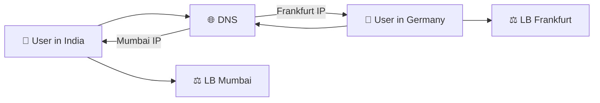

# 03 · DNS Load Balancing

> [!info] Topic info
> **Subject:** System Design · **Chapter:** Load Balancing · **Priority:** ⚡ Medium · **Status:** ✅ done · **Last reviewed:** 2026-11-19
>
> [← Back to Load Balancing](README.md) · [Interview questions →](questions/load-balancing-qa.md)

> [!abstract] In one line
> **DNS load balancing** spreads users by having DNS return **different IP addresses** for the same domain — often based on the user's **location** or **server health**.

---

## 1. The problem

Our app now runs in two regions: Mumbai and Frankfurt. Each has its own [load balancer](01-load-balancers.md).
But a load balancer can't spread traffic across continents — something must decide **which region** a user goes to *before* they connect. DNS is the first thing every client asks, so it's a natural place. (DNS basics: [DNS](../networking/05-dns.md).)

---

## 2. How it works

The client asks "what's the IP of `api.ourapp.com`?" The DNS server picks one answer and returns it.

Ways DNS can choose:

- **Round robin DNS** — return the IP list in a rotating order.
- **Weighted** — 90% get region A, 10% get region B (handy for migrations).
- **Geo / latency-based** — return the region closest to the user.
- **Failover** — health-check each region; stop returning a dead one.

Managed services like AWS Route 53, Cloudflare DNS, and NS1 do all of these.

---

## 3. The big catch — caching and TTL

DNS answers are **cached** by browsers, OSes, and ISP resolvers for the **TTL** (time to live), e.g. 60 s or 1 hour.
So if Mumbai dies, users who cached the Mumbai IP keep going there until their cache expires.

> [!warning] Slow failover
> - Low TTL (30–60 s) = faster failover, but more DNS queries.
> - Some resolvers and apps **ignore TTL** and cache longer anyway.
> - DNS knows nothing about live server load — it can't balance like a real LB.

Also, the DNS server sees the **resolver's** location, not the user's. A user on a far-away public resolver may get the wrong region (the EDNS Client Subnet extension helps with this).

---

## 4. DNS LB vs a real load balancer

| | **DNS load balancing** | **Load balancer (L4/L7)** |
|---|---|---|
| **Scope** | Across regions (global) | Inside one region |
| **Failover speed** | Minutes (TTL) | Seconds |
| **Knows live load** | No | Yes |
| **Extra hop** | None — client connects directly | Every request passes through it |

They're not rivals: DNS picks the **region**, the LB picks the **server**.

> [!tip] 🎤 Say it like this
> "I'd use DNS-based load balancing to route users to the nearest healthy region, with a low TTL like 60 seconds. Inside each region a normal load balancer spreads requests across servers. DNS alone isn't enough because caching makes failover slow and it has no idea about real server load."

> [!failure] Interview traps
> - Using DNS as the only load balancer and expecting instant failover.
> - Forgetting TTL is a trade-off: low TTL means faster failover but more DNS traffic.
> - Assuming every client respects the TTL.

---

## Summary

- DNS returns different IPs → users spread across servers or regions.
- Policies: round robin, weighted, geo/latency, failover.
- Weak spot: **caching/TTL** → slow failover, no live load info.
- Best use: **global** layer on top of regional load balancers.

> [!success] Key takeaway
> DNS chooses the region, the load balancer chooses the server. Keep TTLs low if you rely on DNS for failover.
