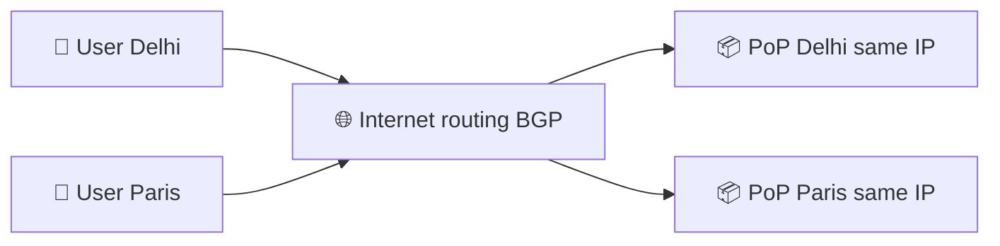

# 04 · Anycast Routing

> [!info] Topic info
> **Subject:** System Design · **Chapter:** Load Balancing · **Priority:** 💤 Low · **Status:** ✅ done · **Last reviewed:** 2026-11-19
>
> [← Back to Load Balancing](README.md) · [Interview questions →](questions/load-balancing-qa.md)

> [!abstract] In one line
> **Anycast** means **many servers in different places announce the same IP address**, and internet routing sends each user to the **nearest** one.

---

## 1. The problem

[DNS load balancing](03-dns-load-balancing.md) picks a region, but caching makes failover slow.
For things like a CDN or a DNS service itself, we want users to reach the closest location instantly and fail over **without waiting for any TTL**.

---

## 2. How it works

Normally one IP = one machine (**unicast**). With anycast, 50 data centers all advertise the same IP, like `1.1.1.1`.
Internet routers (using **BGP**, the protocol networks use to share routes) pick the shortest path, so a user in Delhi lands in Delhi and a user in Paris lands in Paris.

If the Delhi location goes down, it **stops announcing** the IP and routers send Delhi users to the next-nearest location. No DNS change needed.

---

## 3. Where it's used

- **DNS resolvers** — Google `8.8.8.8`, Cloudflare `1.1.1.1`.
- **CDNs** — Cloudflare routes all traffic to the nearest edge.
- **DDoS protection** — attack traffic gets split across many locations instead of hitting one.

**✅ Pros**
- Lowest latency — nearest location wins.
- Fast failover — no TTL caching.
- Absorbs DDoS naturally.

**❌ Cons**
- "Nearest" is in network hops, not always lowest latency.
- A route change mid-connection can send packets to a different site and break long TCP sessions.
- Needs your own IP range and BGP setup — usually only big providers or CDNs do it.

> [!tip] 🎤 Say it like this
> "Anycast lets many locations share one IP, and BGP routing sends each user to the closest one. It's how CDNs and public DNS like 1.1.1.1 work. Failover is fast because a broken site just stops announcing the route — no DNS TTL to wait for. It suits short requests like DNS or CDN traffic."

> [!failure] Interview traps
> - Mixing it up with DNS geo routing — anycast works at the **network layer**, one IP for everyone.
> - Saying anycast balances by load — it routes by network distance, not server load.

---

## Summary

| | **DNS geo routing** | **Anycast** |
|---|---|---|
| **IP per location** | Different | Same |
| **Failover** | Waits for TTL | Route withdrawn, fast |
| **Who decides** | DNS server | Internet routers |

> [!success] Key takeaway
> Anycast = one IP, many places, nearest wins. Know it for CDNs, public DNS, and DDoS defense.
