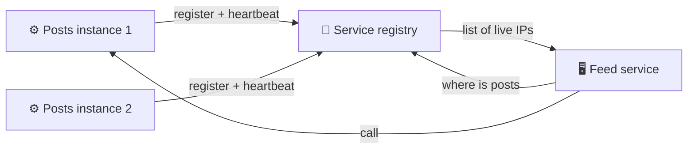
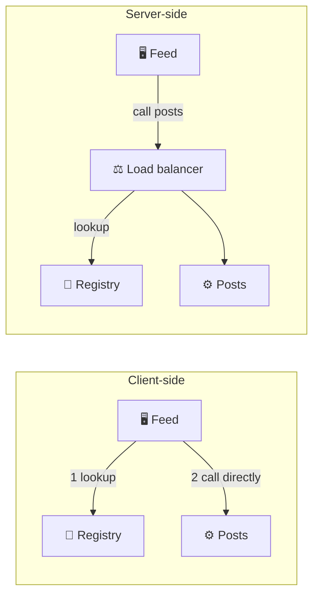

# 01 · Service Discovery

> [!info] Topic info
> **Subject:** System Design · **Chapter:** Microservices Patterns · **Priority:** 🔥 High · **Status:** ✅ done · **Last reviewed:** 2026-11-19
>
> [← Back to Microservices Patterns](README.md) · [Interview questions →](questions/microservices-patterns-qa.md)

> [!abstract] In one line
> **Service discovery** is how one service finds the **current network address** of another, using a **service registry** that always knows which instances are **alive** right now.

---

## 1. The problem

Our social media app is now split into [microservices](../architectural-patterns/03-microservices.md): Feed, Posts, Users, Notifications. The Feed service needs to call the Posts service.

In the old days we'd hard-code `posts-server-1:8080` in a config file. But now Posts runs **10 instances** that auto-scale up and down, crash, and get redeployed with **new IPs** every few minutes. A hard-coded list is wrong within an hour.

So the question is: **"Where is the Posts service right now?"**

---

## 2. How it works — the service registry

A **service registry** is a small, highly available database of `service name → list of healthy IP:port`.

1. **Register** — when a Posts instance starts, it registers itself: "posts at 10.0.3.7:8080".
2. **Health check** — the registry checks it every few seconds (or the instance sends a **heartbeat**). No heartbeat for ~10–30 s → removed.
3. **Deregister** — on clean shutdown, the instance removes itself.
4. **Lookup** — Feed asks "where is posts?" and gets the live list.

Common registries: **Consul**, **etcd**, **ZooKeeper**, **Netflix Eureka**. In Kubernetes, the API server + etcd play this role for you.

> [!note] The registry must not be a SPOF
> If the registry is down, nobody can find anybody. So it runs as a **cluster** (3 or 5 nodes, using [consensus](../distributed-systems/11-consensus.md) like Raft), and clients **cache** the last known list so they survive a short registry outage. See [Single Point of Failure](../core-concepts/04-single-point-of-failure.md).

---

## 3. Client-side vs server-side discovery

The big interview question: **who does the lookup and picks the instance?**

**Client-side discovery** — the caller asks the registry, gets the list, and does its own [load balancing](../load-balancing/02-load-balancing-algorithms.md) (e.g. round robin). Netflix Eureka + Ribbon is the classic example.

**Server-side discovery** — the caller just calls a fixed address (a load balancer or router). The **load balancer** talks to the registry and picks the instance. AWS ALB and Kubernetes Services work like this.

| | Client-side | Server-side |
|---|---|---|
| **Who picks the instance** | The calling service | A load balancer / router |
| **Extra network hop** | No — calls go direct | Yes — through the LB |
| **Client complexity** | High — needs a discovery library in every language | Low — client just calls one address |
| **Smart routing** | Easy — client knows all instances | Done centrally in the LB |
| **Examples** | Eureka + Ribbon, gRPC client-side LB | AWS ALB, Kubernetes Service, Consul + proxy |

> [!tip] 🎤 Say it like this
> "Service discovery answers 'where is service X right now?'. Instances register in a registry like Consul or etcd and are removed when health checks fail. With client-side discovery the caller looks up the list and load-balances itself — no extra hop, but every client needs a library. With server-side discovery the caller hits a load balancer that does the lookup — simpler clients, one more hop."

---

## 4. DNS-based discovery and Kubernetes

The simplest form: just use [DNS](../networking/05-dns.md). `posts.internal` resolves to the current IPs.

In **Kubernetes**, every Service gets a DNS name like `posts.default.svc.cluster.local`. It points to a stable **virtual IP**, and kube-proxy forwards traffic to the healthy pods behind it. Your code just calls `http://posts` — discovery is invisible.

> [!warning] DNS caching trap
> Plain DNS has **TTLs** and clients (JVMs especially) cache results, sometimes forever. A dead instance can keep getting traffic for minutes. That's why Kubernetes uses a stable virtual IP instead of returning pod IPs directly, and why you keep DNS TTLs low (5–30 s).

> [!failure] Interview traps
> - Saying "just put IPs in a config file" — breaks with auto-scaling and redeploys.
> - Forgetting **health checks** — a registry that lists dead instances is worse than none.
> - Making the registry a **single point of failure** — it must be clustered and clients should cache.
> - Confusing discovery with load balancing — discovery finds the **list**, load balancing **picks one**.

---

## Summary

| Idea | What it fixes |
|---|---|
| **Service registry** | One live list of who is where |
| **Health checks / heartbeats** | Dead instances drop out automatically |
| **Client-side discovery** | No extra hop, smart routing — but a library in every client |
| **Server-side discovery** | Simple clients — but an extra hop through an LB |
| **DNS / Kubernetes Services** | Discovery for free, as long as you watch caching |

> [!success] Key takeaway
> In a dynamic world, never hard-code addresses. Register, health-check, and look up — and on Kubernetes, the platform already does it for you.
