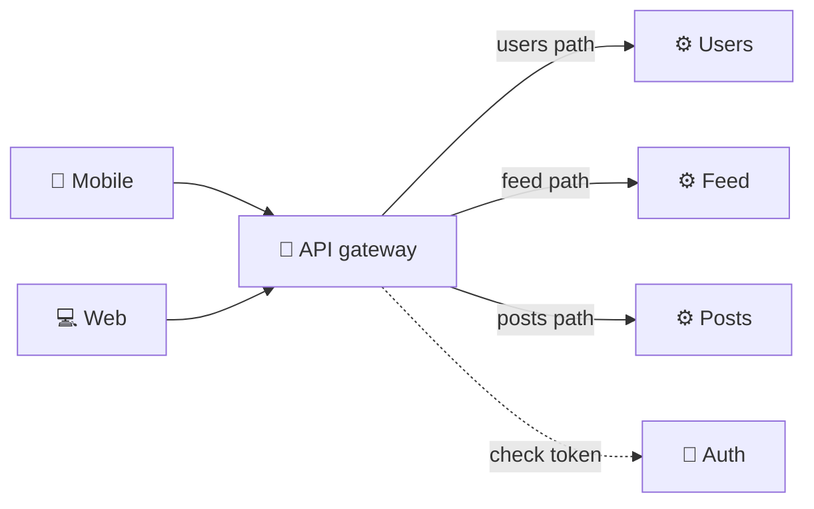

# 02 · API Gateway

> [!info] Topic info
> **Subject:** System Design · **Chapter:** Microservices Patterns · **Priority:** 🔥 High · **Status:** ✅ done · **Last reviewed:** 2026-11-19
>
> [← Back to Microservices Patterns](README.md) · [Interview questions →](questions/microservices-patterns-qa.md)

> [!abstract] In one line
> An **API gateway** is the **single front door** for all clients — it **routes** each request to the right microservice and handles shared jobs like **auth, rate limiting, and SSL** in one place.

---

## 1. The problem

Our social media app has 20 microservices. Without a gateway, the mobile app must know 20 hostnames, and **every** service has to re-implement login checks, rate limits, CORS, and logging.

Worse: if we split or rename a service, every client version in the app stores breaks. And opening the home screen needs data from Users, Feed, and Notifications — **3 round trips** over a slow mobile network.

---

## 2. How it works

All clients call one address: `api.socialapp.com`. The gateway looks at the path and forwards the request.

What the gateway usually does (the "cross-cutting concerns"):

- **Routing** — `/feed/*` → Feed service, using [service discovery](01-service-discovery.md).
- **Authentication** — verify the [JWT](../api-fundamentals/11-jwt.md) once, pass the user ID to services.
- **[Rate limiting](../api-fundamentals/08-rate-limiting.md)** — e.g. 100 req/min per user.
- **SSL termination** — decrypt HTTPS at the edge.
- **Request aggregation** — one client call → gateway calls 3 services → one combined response.
- **Protocol translation** — REST/JSON outside, [gRPC](../api-fundamentals/07-grpc.md) inside.
- **Logging, metrics, caching, API versioning.**

Examples: **Kong**, **AWS API Gateway**, **Apigee**, **NGINX**, **Envoy**, Spring Cloud Gateway.

> [!tip] 🎤 Say it like this
> "An API gateway is the single entry point for clients. It routes requests to the right microservice and handles cross-cutting concerns — auth, rate limiting, SSL, logging — so services don't each re-implement them. It also hides the internal service layout, so I can split or move services without breaking clients."

---

## 3. Gateway vs load balancer vs reverse proxy

These overlap a lot, and interviewers love asking the difference. A [reverse proxy](../networking/06-proxy-vs-reverse-proxy.md) is the general idea; a [load balancer](../load-balancing/01-load-balancers.md) and an API gateway are specialised reverse proxies.

| | Reverse proxy | Load balancer | API gateway |
|---|---|---|---|
| **Main job** | Sit in front of servers, forward requests | Spread traffic across **copies of the same** service | Route to **different** services + API concerns |
| **Knows about** | Hosts, paths | Server health, load | Users, API keys, routes, versions |
| **Typical extras** | SSL, caching, compression | Health checks, algorithms | Auth, rate limits, aggregation, transformation |
| **Layer** | L7 | L4 or L7 | L7 only |
| **Example** | NGINX | AWS ALB/NLB, HAProxy | Kong, AWS API Gateway |

In real systems you often have both: **LB → gateway cluster → services**, and each service may have its own LB behind it.

> [!example] Hotel analogy
> The **reverse proxy** is the front door. The **load balancer** sends you to any free receptionist. The **API gateway** is the concierge — checks your ID, knows which department handles your request, and limits how often you can ask.

---

## 4. Trade-offs

**✅ Pros**
- Clients see one simple, stable API.
- Auth, rate limits, logging written **once**.
- Fewer round trips via aggregation — big win on mobile.
- Freedom to refactor services behind it.

**❌ Cons**
- **Extra hop** — adds a few ms of latency.
- **Single point of failure** — must run as a cluster behind an LB.
- Can become a **bottleneck** for team velocity if one team owns all routes.
- Risk of a "smart gateway" — business logic creeping in.

> [!warning] Keep the gateway dumb
> The gateway should route and enforce policies, not decide "show premium posts first". Business logic in the gateway turns it into a new monolith that every team has to change.

> [!failure] Interview traps
> - Saying a gateway and a load balancer are the same thing — the LB balances copies of **one** service; the gateway routes **between** services.
> - Drawing one gateway box with no redundancy — it's a SPOF unless clustered.
> - Doing **authorization** of business rules only at the gateway — services should still check "can this user edit this post?".
> - Forgetting the gateway is for **north-south** traffic (client → system). Service-to-service (east-west) traffic is the [service mesh](08-service-mesh.md)'s job.

---

## Summary

- One front door → clients don't know your internal layout.
- Handles cross-cutting concerns: routing, auth, rate limiting, SSL, aggregation.
- Different from an LB (copies of one service) and a generic reverse proxy (the base idea).
- Cluster it, keep it thin, keep business logic out.
- Different clients need different APIs? → [Backend for Frontend](03-backend-for-frontend.md).

> [!success] Key takeaway
> The API gateway is the **front door and bouncer** of a microservices system — simple for clients, shared policies in one place, but keep it thin and redundant.
