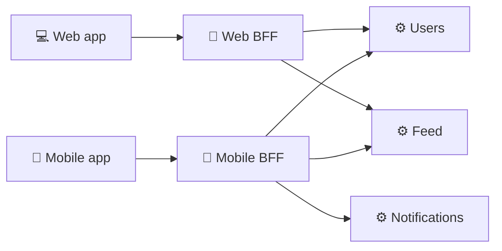

# 03 · Backend for Frontend (BFF)

> [!info] Topic info
> **Subject:** System Design · **Chapter:** Microservices Patterns · **Priority:** ⚡ Medium · **Status:** ✅ done · **Last reviewed:** 2026-11-19
>
> [← Back to Microservices Patterns](README.md) · [Interview questions →](questions/microservices-patterns-qa.md)

> [!abstract] In one line
> **Backend for Frontend** means giving **each client type** (web, mobile, TV) its **own small backend/gateway**, shaped exactly for what that screen needs.

---

## 1. The problem

Our social app has one [API gateway](02-api-gateway.md) serving web, iOS, and Android. But the clients want very different things:

- **Web** feed shows 50 posts with full comments and big images.
- **Mobile** feed shows 10 posts, thumbnails only, and must be **small** — users are on 4G.
- **Smart TV** only needs videos.

One generic API either sends too much (mobile wastes data) or too little (web makes 5 extra calls). And the gateway fills up with `if (client == "ios")` code that three teams fight over.

---

## 2. How it works

Instead of one gateway for everyone, build **one thin backend per frontend**. Each BFF calls the same downstream services but **aggregates and trims** data for its own client.

- The **mobile team owns the mobile BFF**, the web team owns the web BFF. They ship without waiting on each other.
- A BFF does: **aggregation** (one call → many services), **shaping** (drop fields, resize images), and client-specific auth or session handling.
- Shared stuff like SSL and global rate limits can still sit in a common edge gateway in front.

> [!note] BFF vs GraphQL
> [GraphQL](../api-fundamentals/06-graphql.md) solves part of the same problem — each client asks for exactly the fields it needs from one endpoint. Many teams use GraphQL **instead of** separate BFFs, or **as** the BFF layer.

> [!tip] 🎤 Say it like this
> "BFF means one backend per client type. Mobile and web need very different data shapes, so instead of one bloated general API, each frontend gets its own thin backend that aggregates calls and trims the response. It's usually owned by the same team that builds the frontend, so they can move independently."

---

## 3. Trade-offs and when to use

**✅ Pros**
- Smaller, faster responses for each client — less mobile data, fewer round trips.
- Frontend teams move independently.
- No `if client == ...` mess in one shared gateway.

**❌ Cons**
- **More services** to deploy, monitor, and secure.
- **Duplicated logic** across BFFs (e.g. both format a "post card").
- Pointless if all your clients need the same data.

**Use it when** clients differ a lot (web vs mobile vs TV vs partner API) and separate teams own them. **Skip it** for a single web app, or when GraphQL already covers the differences.

> [!failure] Interview traps
> - Putting **core business logic** in the BFF — it should only aggregate and shape. Rules like "who can see this post" live in the services.
> - Creating one BFF per **screen** or per **team member** — it's one per **client type / experience**.
> - Fixing duplication by merging BFFs back into one — share code via a library instead.

---

## Summary

| Idea | What it fixes |
|---|---|
| **One BFF per client type** | Each client gets exactly the data it needs |
| **Aggregation in the BFF** | Fewer round trips from slow networks |
| **Frontend team owns its BFF** | Teams ship without blocking each other |

> [!success] Key takeaway
> BFF = "one size does **not** fit all clients". Use it when web and mobile need very different APIs; skip it when they don't.
