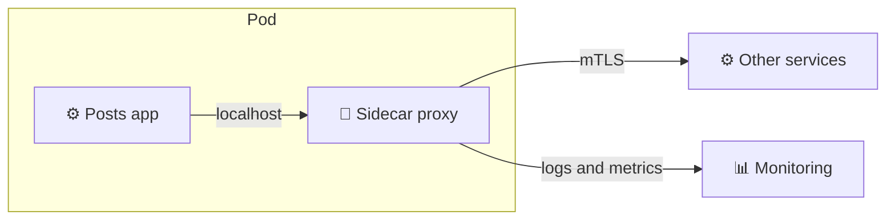

# 04 · Sidecar Pattern

> [!info] Topic info
> **Subject:** System Design · **Chapter:** Microservices Patterns · **Priority:** 💤 Low · **Status:** ✅ done · **Last reviewed:** 2026-11-19
>
> [← Back to Microservices Patterns](README.md) · [Interview questions →](questions/microservices-patterns-qa.md)

> [!abstract] In one line
> A **sidecar** is a **helper process deployed next to each service instance** (same host / same pod) that handles **shared infrastructure jobs** — logging, proxying, TLS, config — so the app code doesn't have to.

---

## 1. The problem

Our app has 30 services in Java, Go, Node, and Python. Every one of them needs logging, metrics, TLS, retries, and config reloads.

Writing a library for each of these in **4 languages** is slow, and keeping them all upgraded is painful. We want this logic **outside** the app code.

---

## 2. How it works

Run a second container **beside** the app, sharing its network and disk. Like a motorbike sidecar — attached, travels with it, but a separate thing.

- The app talks to `localhost`; the sidecar does the hard network work.
- Same lifecycle: starts, scales, and dies with the app instance.
- In **Kubernetes**, it's just an extra container in the same pod.

**Common sidecars:**
- **Proxy** (Envoy) — retries, timeouts, mTLS, routing → this is how a [service mesh](08-service-mesh.md) works.
- **Log shipper** (Fluent Bit) — reads log files and sends them to central [log aggregation](../observability/03-log-aggregation.md).
- **Secrets / config agent** (Vault agent) — fetches and refreshes secrets.

> [!tip] 🎤 Say it like this
> "A sidecar is a helper container deployed next to each service instance. It handles cross-cutting work like proxying, TLS, logging, or secret fetching, so the app stays focused on business logic and it works the same for any language. Service meshes like Istio are built on Envoy sidecars."

**✅ Pros**
- Language-agnostic — one sidecar works for Java, Go, Python alike.
- Update infra logic without redeploying app code.
- Clean separation: app = business, sidecar = plumbing.

**❌ Cons**
- More resources — 1,000 pods means 1,000 extra containers (CPU + memory).
- Extra local hop adds a little latency (usually ~1 ms or less).
- More moving parts to debug.

> [!failure] Interview traps
> - Calling any separate service a "sidecar" — it must be **co-located 1:1** with the app instance.
> - Ignoring the resource cost at scale — newer meshes (e.g. Istio ambient mode) move to a per-node proxy partly for this reason.

---

## Summary

- Sidecar = helper container beside each app instance, sharing its network.
- Moves cross-cutting plumbing out of app code, works for any language.
- Foundation of the service mesh.

> [!success] Key takeaway
> Sidecar = **"plumbing in a separate container, glued to every instance."** Great for polyglot systems; watch the resource cost.
