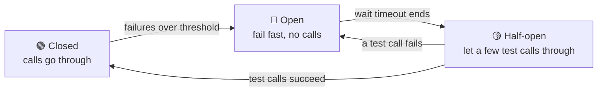
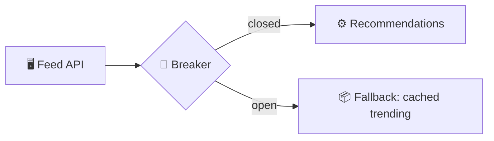

# 05 · Circuit Breaker

> [!info] Topic info
> **Subject:** System Design · **Chapter:** Microservices Patterns · **Priority:** 🔥 High · **Status:** ✅ done · **Last reviewed:** 2026-11-19
>
> [← Back to Microservices Patterns](README.md) · [Interview questions →](questions/microservices-patterns-qa.md)

> [!abstract] In one line
> A **circuit breaker** wraps calls to a dependency and, after **too many failures**, **stops calling it for a while** and **fails fast** (with a fallback) — giving the sick service time to recover and protecting the caller.

---

## 1. The problem

Quick recap from [Availability §11–12](../core-concepts/02-availability.md): our Feed API calls the Recommendations service. Recommendations slows from 50 ms to **5 s**. Feed's 200 threads all get stuck waiting, and Feed goes down **even though it has no bug**. That's a **cascading failure**.

[Timeouts](../distributed-systems/05-handling-failures.md) help — we give up after 300 ms. But we still **try** every request, wait 300 ms each time, and keep hammering a service that's already drowning. We need something that **remembers** the service is broken and stops calling it.

---

## 2. The three states

The name comes from the electrical breaker in your house: too much current → it trips and cuts the power, protecting the wiring.

- **🟢 Closed (normal)** — every call goes through. The breaker **counts failures** (errors and timeouts) in a sliding window.
- **🔴 Open (tripped)** — failure rate crossed the threshold. Calls **don't even try** — they fail instantly and go to the fallback. Takes ~0 ms instead of 300 ms.
- **🟡 Half-open (testing)** — after a cool-down (e.g. 30 s), let a **few trial requests** through. If they succeed → back to Closed. If any fail → back to Open for another cool-down.

> [!tip] 🎤 Say it like this
> "A circuit breaker sits in front of a remote call and tracks failures. When the failure rate crosses a threshold, it opens and fails fast for a cool-down period, so we stop wasting threads and stop hammering a sick service. After the cool-down it goes half-open and lets a few test calls through — success closes it, failure opens it again. While open, we serve a fallback."

---

## 3. Thresholds — tuning it

Typical settings (e.g. in **Resilience4j**, Polly, or an Envoy/Istio mesh):

| Setting | Example | Why |
|---|---|---|
| **Failure rate threshold** | Open if **≥ 50%** of calls fail | Rate, not raw count — scales with traffic |
| **Sliding window** | Last **100 calls** or last **10 s** | What "recent" means |
| **Minimum calls** | At least **20 calls** in the window | Don't trip on 1 failure out of 2 at 3 a.m. |
| **Slow call threshold** | Calls > **1 s** count as failures | Slow is worse than dead |
| **Open duration** | **30 s** before half-open | Time for the service to recover |
| **Half-open trial calls** | **5** test calls | Small probe, not a flood |

> [!warning] What counts as a failure?
> Count **5xx errors and timeouts**. Don't count **4xx** like 404 or 400 — those are the caller's fault, not a sick service. Otherwise one buggy client can trip the breaker for everyone.

---

## 4. Fallbacks — what to return when open

Failing fast is only half the story. What does the user see?

- **Cached data** — last good recommendations from Redis.
- **Default / generic** — "Trending posts" instead of personalised ones.
- **Degraded feature** — hide the "People you may know" box.
- **Fail clearly** — for critical calls (payments), return an error fast; never fake a success.

This is [graceful degradation](../core-concepts/02-availability.md): the feed still loads, just simpler.

---

## 5. How it fits with other patterns

| Pattern | Role |
|---|---|
| **Timeout** | Limits how long **one** call waits |
| **Retry + backoff** | Handles **brief** blips. Must be inside the breaker, so retries stop when it opens |
| **Circuit breaker** | Handles **ongoing** failure — stops calling altogether |
| **[Bulkhead](06-bulkhead.md)** | Limits **how many** calls can wait at once |

**✅ Pros**
- Stops cascading failures and retry storms.
- Callers respond in ~0 ms instead of waiting on timeouts.
- Gives the failing service breathing room to recover.

**❌ Cons**
- Thresholds are tricky — too sensitive trips on noise, too loose reacts too late.
- Users see degraded results while open.
- Per-instance breakers can disagree (one caller's breaker open, another's closed) — usually fine.

> [!failure] Interview traps
> - Forgetting the **half-open** state — without it, how would the breaker ever close?
> - Opening on a **raw failure count** with no minimum — low traffic trips it on noise.
> - Using a breaker with **no fallback** plan — "fail fast" with nothing to show is still an error page.
> - Thinking breakers replace timeouts — you need **both**; the breaker counts timeouts as failures.

---

## Summary

| Step | What it fixes |
|---|---|
| **Timeout** | No call waits forever |
| **Closed → Open** | Stop calling a broken service, fail fast |
| **Half-open** | Safely test if it recovered |
| **Fallback** | User still gets something useful |

> [!success] Key takeaway
> **Fail fast, recover safely.** A circuit breaker turns "slowly dying with your dependency" into "quickly serving a fallback until it's healthy again".
