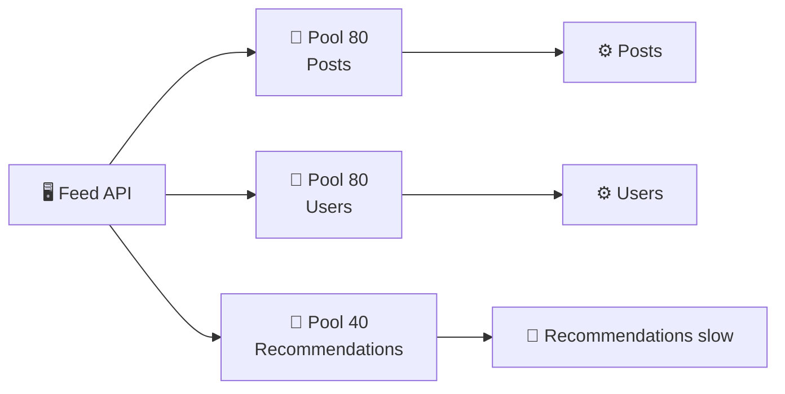

# 06 · Bulkhead

> [!info] Topic info
> **Subject:** System Design · **Chapter:** Microservices Patterns · **Priority:** 💤 Low · **Status:** ✅ done · **Last reviewed:** 2026-11-19
>
> [← Back to Microservices Patterns](README.md) · [Interview questions →](questions/microservices-patterns-qa.md)

> [!abstract] In one line
> A **bulkhead** splits resources (**thread pools, connection pools, instances**) into **separate compartments** per dependency or customer, so one failing part **can't sink the whole service**.

---

## 1. The problem

Recap from [Availability §11](../core-concepts/02-availability.md): our Feed API has **one shared pool of 200 threads**. It calls Users, Posts, and Recommendations.

Recommendations gets slow. Within seconds, all 200 threads are stuck waiting on it. Now calls to Users and Posts — which are perfectly healthy — have **no threads left**. The whole Feed API is down because of one non-critical dependency.

---

## 2. How it works

Ships have watertight walls (**bulkheads**) inside the hull. A hole floods one compartment, not the whole ship. We do the same with resources.

Now if Recommendations hangs, only its **40 threads** fill up. Extra calls to it are **rejected immediately** (→ fallback), while Posts and Users keep their 160 threads. The feed still loads.

**Ways to build bulkheads:**
- **Thread pools per dependency** — as above.
- **Semaphores** — cheaper: just cap "max 40 concurrent calls to Recommendations".
- **Connection pools per database / service** — one slow DB can't grab every connection.
- **Separate instances per customer tier** — premium users get their own servers, so a free-tier traffic spike can't hurt them.
- **Cell-based architecture** — split users into independent "cells", each with its own full stack. One bad cell affects only ~5% of users.

> [!tip] 🎤 Say it like this
> "Bulkhead means isolating resources so one failure can't consume everything. I give each downstream dependency its own small thread or connection pool, so if one service hangs, only its pool fills up and the rest of the app keeps working. It pairs well with a circuit breaker — the bulkhead limits how many calls wait, the breaker stops calling altogether."

**✅ Pros**
- Contains failures to one compartment.
- Protects critical paths from non-critical ones.

**❌ Cons**
- Less efficient — idle threads in one pool can't help a busy one.
- Pool sizes need tuning (use [Little's law](../core-concepts/05-latency-throughput-bandwidth.md): threads ≈ req/s × latency).

> [!failure] Interview traps
> - Confusing bulkhead with circuit breaker — bulkhead **limits concurrency**, breaker **stops calls** after failures. Use both.
> - One giant shared pool "for efficiency" — that's exactly what causes the cascade.

---

## Summary

- One shared pool = one slow dependency can starve all others.
- Bulkhead = separate pools / limits per dependency, tenant, or cell.
- Pair with [circuit breaker](05-circuit-breaker.md), timeouts, and fallbacks.

> [!success] Key takeaway
> **Don't let one leak sink the ship.** Give each dependency its own capped compartment.
