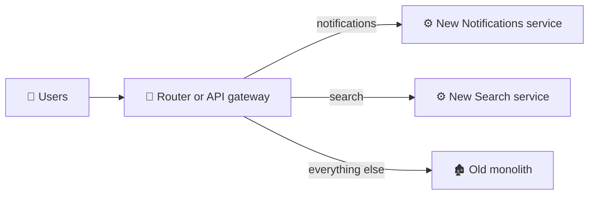

# 07 · Strangler Fig

> [!info] Topic info
> **Subject:** System Design · **Chapter:** Microservices Patterns · **Priority:** 💤 Low · **Status:** ✅ done · **Last reviewed:** 2026-11-19
>
> [← Back to Microservices Patterns](README.md) · [Interview questions →](questions/microservices-patterns-qa.md)

> [!abstract] In one line
> The **strangler fig** pattern replaces a legacy system **piece by piece**: put a **routing layer** in front, move one feature at a time to the new service, until the old system can be **switched off**.

---

## 1. The problem

Our social app started as a 10-year-old [monolith](../architectural-patterns/02-monolith.md). We want [microservices](../architectural-patterns/03-microservices.md). The tempting plan is a **big-bang rewrite**: freeze features for 18 months, build the new system, switch over in one night.

Big-bang rewrites usually fail: the old system keeps changing, the new one misses hidden behaviours, and the cut-over day is a huge risk with no easy way back.

---

## 2. How it works

Named after the strangler fig tree, which grows around a host tree until it fully replaces it.

1. **Put a facade in front** — a reverse proxy or [API gateway](02-api-gateway.md). At first it sends 100% of traffic to the monolith.
2. **Pick one feature** — ideally low-risk and well-bounded, e.g. Notifications.
3. **Build it as a new service** and route its URLs there. Roll out gradually (1% → 10% → 100%) with [canary releases](../deployment/05-canary-releases.md) or feature flags.
4. **Delete the old code** in the monolith.
5. **Repeat** until the monolith is empty → switch it off.

> [!warning] The hard part is the data
> Moving code is easy; moving **data** is not. During migration both systems may need the same tables. Common approaches: new service owns its data and syncs back via [change data capture](../big-data/02-change-data-capture.md) or events, or the new service temporarily reads the old DB through an API.

> [!tip] 🎤 Say it like this
> "Strangler fig is how I'd migrate a monolith without a big-bang rewrite. I put a routing layer in front, extract one feature at a time into a new service, shift traffic gradually, and delete the old code. At every step the system works and I can roll back by flipping the route."

**✅ Pros**
- Low risk — small steps, easy rollback by changing a route.
- Value ships continuously, no feature freeze.

**❌ Cons**
- Migration can drag on for years; two systems to run meanwhile.
- Data sync between old and new is tricky.

> [!failure] Interview traps
> - Starting with the **most core, tangled** feature — start small and well-bounded.
> - Never actually **deleting** the old code — you end up with two systems forever.

---

## Summary

- Facade in front → move one feature at a time → delete the old part → repeat.
- Safer than a big-bang rewrite; the data migration is the tricky bit.

> [!success] Key takeaway
> **Replace, don't rewrite.** Grow the new system around the old one until nothing is left.
