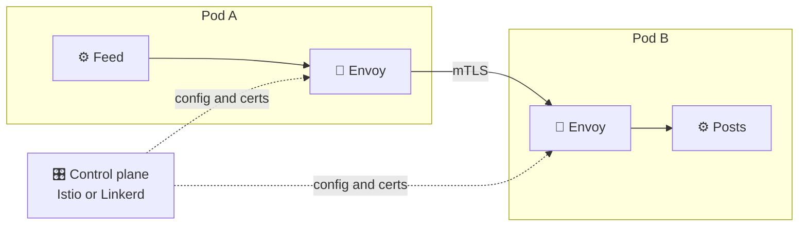

# 08 · Service Mesh

> [!info] Topic info
> **Subject:** System Design · **Chapter:** Microservices Patterns · **Priority:** 💤 Low · **Status:** ✅ done · **Last reviewed:** 2026-11-19
>
> [← Back to Microservices Patterns](README.md) · [Interview questions →](questions/microservices-patterns-qa.md)

> [!abstract] In one line
> A **service mesh** is an infrastructure layer that handles **service-to-service traffic** — **mTLS, retries, timeouts, circuit breaking, and observability** — through **sidecar proxies**, without changing app code.

---

## 1. The problem

Our app now has 50 services. Every call between them needs timeouts, retries, [circuit breakers](05-circuit-breaker.md), encryption, and tracing.

Doing that in a library per language means 4 libraries, inconsistent behaviour, and redeploying 50 services to change one retry setting. And security asks: "Is internal traffic encrypted? Can the Search service call Payments?" — nobody knows.

---

## 2. How it works

Put a [sidecar](04-sidecar.md) proxy (usually **Envoy**) next to every service. All traffic in and out goes through it. A central **control plane** tells all proxies what to do.

- **Data plane** — the sidecar proxies that actually carry traffic.
- **Control plane** — pushes config, routes, and certificates to all proxies (Istio's istiod, Linkerd's control plane).

**What you get, without touching app code:**
- **mTLS** (mutual TLS) — both sides prove identity with certificates; all internal traffic encrypted. Certs rotated automatically.
- **Access policy** — "only Feed may call Posts" (zero trust).
- **Resilience** — retries, timeouts, circuit breaking set in config.
- **Traffic control** — send 5% to v2 for [canary releases](../deployment/05-canary-releases.md).
- **Observability** — latency, error rate, and [distributed tracing](../observability/05-distributed-tracing.md) for every call.

> [!note] Gateway vs mesh
> The [API gateway](02-api-gateway.md) handles **north-south** traffic (outside clients → your system). The mesh handles **east-west** traffic (service ↔ service inside). Many systems use both.

> [!tip] 🎤 Say it like this
> "A service mesh moves networking concerns out of the app into sidecar proxies like Envoy, managed by a control plane like Istio. Every service-to-service call automatically gets mTLS, retries, timeouts, and tracing. It's great at scale with many teams and languages, but for a handful of services it's usually overkill."

---

## 3. When it's overkill

**✅ Pros**
- Consistent security and resilience across all languages.
- Change policies centrally without redeploying apps.
- Free, uniform metrics and tracing.

**❌ Cons**
- **Complex** to run and debug — a new system your team must learn.
- **Resource cost** — one proxy per pod; ~1–3 ms extra latency per hop.
- Hard-to-find bugs when the proxy, not the app, misbehaves.

**Use it when** you have dozens of services, many languages, and strict security needs (mTLS everywhere). **Skip it** with 5–10 services — a good library plus an API gateway is enough.

> [!failure] Interview traps
> - Adding a mesh to a small system "because Netflix does" — complexity cost > benefit.
> - Retries in **both** the app and the mesh — retry storms. Pick one layer.
> - Thinking the mesh replaces the API gateway — different traffic directions.

---

## Summary

- Sidecar proxies (data plane) + control plane = service mesh.
- Gives mTLS, policies, retries, traffic splitting, and observability for free.
- Worth it at large scale; overkill for small systems.

> [!success] Key takeaway
> A service mesh is **networking as infrastructure** — powerful for 50+ services, heavy for 5.
