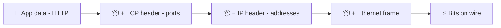

# 01 · OSI Model

> [!info] Topic info
> **Subject:** System Design · **Chapter:** Networking · **Priority:** ⚡ Medium · **Status:** ✅ done · **Last reviewed:** 2026-11-19
>
> [← Back to Networking](README.md) · [Interview questions →](questions/networking-qa.md)

> [!abstract] In one line
> The **OSI model** splits networking into **7 layers**, each with one job. In system design you mostly care about **Layer 4 (TCP/UDP)** and **Layer 7 (HTTP)** — that's where load balancers, proxies and firewalls make decisions.

---

## 1. The problem

A user in Mumbai opens our social media app and loads their feed. That one click goes through Wi-Fi, routers, cables, TCP, TLS and HTTP before it reaches our server.

If something breaks, "the network is down" is useless. We need a shared map to say **where** it broke — and to describe **what a component can see**. That map is the OSI model.

---

## 2. The 7 layers (only what matters)

| # | Layer | Job | Example |
|---|---|---|---|
| **7** | Application | What the app speaks | HTTP, gRPC, DNS, SMTP |
| **6** | Presentation | Format, encrypt | TLS, JSON, compression |
| **5** | Session | Keep a conversation open | Sessions, reconnects |
| **4** | Transport | Process-to-process delivery, ports | TCP, UDP |
| **3** | Network | Route between networks, IP addresses | IP, routers |
| **2** | Data link | Deliver within one local network | Ethernet, MAC, switches |
| **1** | Physical | Bits on a wire | Cables, fibre, radio |

In real life, the internet uses the simpler **TCP/IP model** (4 layers). Layers 5–7 are merged into one "application" layer. Interviewers still say "L4" and "L7" using OSI numbers.

Each layer wraps the data from the layer above with its own header. This is called **encapsulation**. The receiver unwraps it in reverse.

> [!example] Memory trick
> 7 → 1: **A**ll **P**eople **S**eem **T**o **N**eed **D**ata **P**rocessing.

For more depth, see [OSI and TCP/IP models](../../computer-networks/deep-dives/osi-and-tcp-ip-models.md).

---

## 3. Why system designers care: L4 vs L7

The layer a component works at decides **what it can see** and **what it can do**.

| | **L4 (Transport)** | **L7 (Application)** |
|---|---|---|
| **Sees** | IP + port only | Full request: URL, headers, cookies, body |
| **Can route by** | IP/port | Path (`/api` vs `/images`), host, header, user |
| **Speed** | Very fast, cheap | Slower — must parse and often decrypt TLS |
| **Examples** | AWS NLB, simple TCP proxies | Nginx, Envoy, AWS ALB, API gateway |
| **Use for** | Raw speed, non-HTTP traffic, millions of connections | Smart routing, auth, caching, rate limits |

For our app: send `/api/*` to API servers and `/media/*` to the media service → that needs an **L7** load balancer. A game server or database proxy that just forwards TCP → **L4** is enough.

> [!tip] 🎤 Say it like this
> "The OSI model splits networking into 7 layers. In system design the two that matter most are L4, where TCP and UDP work with IPs and ports, and L7, where HTTP lives. An L4 load balancer is fast but only sees IP and port. An L7 one can read the URL and headers, so it can route by path, do auth or cache — at a bit more cost."

> [!failure] Interview traps
> - Saying TLS is "L4". It sits **between** TCP and HTTP — usually called L6 or "L4.5".
> - Thinking an L4 load balancer can route by URL. It can't — it never reads HTTP.
> - Memorising all 7 layers but not knowing **why** L4 vs L7 matters.

---

## Summary

- 7 layers, each with one job. Real internet uses the 4-layer TCP/IP model.
- **L3** = IP routing, **L4** = TCP/UDP + ports, **L7** = HTTP and app data.
- **L4 LB** = fast and dumb. **L7 LB** = smart and a bit slower.
- Debug bottom-up: cable → IP → port → TLS → HTTP.

> [!success] Key takeaway
> Know the layers, but really know **L4 vs L7** — it decides how your load balancers and proxies behave.
