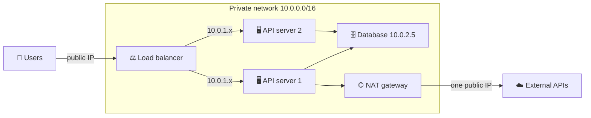

# 02 · IP Address

> [!info] Topic info
> **Subject:** System Design · **Chapter:** Networking · **Priority:** ⚡ Medium · **Status:** ✅ done · **Last reviewed:** 2026-11-19
>
> [← Back to Networking](README.md) · [Interview questions →](questions/networking-qa.md)

> [!abstract] In one line
> An **IP address** is the **address of a machine on a network** so packets know where to go. In system design it matters for **public vs private** networks, **NAT**, **static vs dynamic IPs**, and **IPv4 running out**.

---

## 1. The problem

Our app has a load balancer, 20 API servers, and a database. A user's request must reach the load balancer, and the load balancer must reach the right server.

Every machine needs an address. But we don't want the **database** to be reachable from the internet. So we need two kinds of addresses: public and private.

---

## 2. How it works

**IPv4** is 32 bits, written as 4 numbers: `203.0.113.10`. That's about **4.3 billion** addresses — not enough for every phone and laptop on Earth.

**IPv6** is 128 bits: `2001:db8::1`. Practically unlimited. Adoption is growing but IPv4 is still everywhere, so most systems support both.

### Public vs private

- **Public IP** — reachable from the internet. Only the edge (load balancer, CDN, NAT gateway) gets one.
- **Private IP** — only works inside your network. Ranges: `10.x.x.x`, `172.16–31.x.x`, `192.168.x.x`.

**NAT (Network Address Translation)** lets many private machines share one public IP for **outgoing** calls. Our servers can call Stripe, but nobody outside can start a connection to them.

### CIDR — writing a range

`10.0.0.0/16` means "the first 16 bits are fixed" → 65,536 addresses. `/24` → 256 addresses. Clouds use this to define networks (VPCs) and subnets.

> [!note] Static vs dynamic
> Servers behind a load balancer get **dynamic** IPs that change when they restart. That's why we never hard-code IPs — use **DNS** or **service discovery** instead. See [Service discovery](../microservices-patterns/01-service-discovery.md).

For subnetting math, see [IP addressing and subnetting](../../computer-networks/deep-dives/ip-addressing-and-subnetting.md).

> [!tip] 🎤 Say it like this
> "An IP address identifies a machine on a network. In a real system, only the edge — the load balancer or CDN — has a public IP. App servers and databases sit in a private subnet with private IPs, and they reach the internet through a NAT gateway. Since server IPs change, we use DNS or service discovery instead of hard-coding them."

> [!failure] Interview traps
> - Putting the database in a public subnet "for easy access" — a big security hole.
> - Hard-coding server IPs in config. They change on restart or autoscaling.
> - Rate limiting only by IP — thousands of users behind one office or mobile NAT share one IP.

---

## Summary

| Idea | Why it matters |
|---|---|
| **IPv4 vs IPv6** | IPv4 ran out; support both |
| **Public vs private** | Only the edge is public; DB stays private |
| **NAT** | Private servers make outgoing calls safely |
| **CIDR** | How VPCs and subnets are sized |
| **Dynamic IPs** | Use DNS / service discovery, not raw IPs |

> [!success] Key takeaway
> Public IPs at the edge, private IPs everywhere else, and never depend on a server's IP staying the same.
