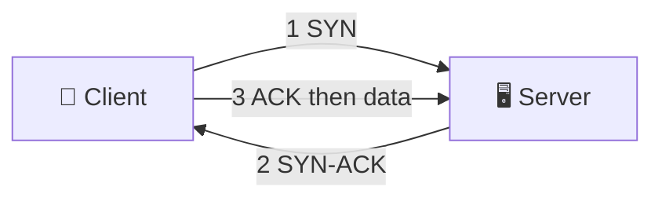

# 03 · TCP vs UDP

> [!info] Topic info
> **Subject:** System Design · **Chapter:** Networking · **Priority:** 🔥 High · **Status:** ✅ done · **Last reviewed:** 2026-11-19
>
> [← Back to Networking](README.md) · [Interview questions →](questions/networking-qa.md)

> [!abstract] In one line
> **TCP** is **reliable and ordered** but slower to start; **UDP** is **fast and fire-and-forget** with no guarantees. Pick TCP when every byte matters, UDP when **fresh data beats complete data**.

---

## 1. The problem

Our social media app now has two features:

- 💬 **Posts and payments** — losing or reordering even one byte is a bug.
- 📹 **Live video calls** — a frame that arrives 500 ms late is useless. Better to skip it.

One transport can't be best at both. That's why we have two.

---

## 2. TCP — reliable delivery

**TCP (Transmission Control Protocol)** opens a **connection** first, then guarantees:

- ✅ **Every byte arrives** — lost packets are resent.
- ✅ **In order** — packets are numbered and put back in order.
- ✅ **Flow and congestion control** — slows down if the receiver or network is overloaded.

Before any data, TCP does a **3-way handshake**:

That costs **1 round trip** before the first byte. Add TLS and it's 2–3 round trips. If the server is 100 ms away, that's **200–300 ms** before anything useful happens.

> [!warning] Head-of-line blocking
> If packet #3 is lost, packets #4–#10 wait in the buffer until #3 is resent. One lost packet stalls everything behind it. This is why video over TCP stutters on bad networks.

---

## 3. UDP — just send it

**UDP (User Datagram Protocol)** has no handshake, no resend, no ordering. It just sends packets (called **datagrams**).

- ⚡ Starts instantly — no round trips.
- ⚡ Tiny header (8 bytes vs TCP's 20+).
- ❌ Packets can be lost, duplicated, or arrive out of order. The app must handle it if it cares.

---

## 4. Comparison and when to use

| | **TCP** | **UDP** |
|---|---|---|
| **Connection** | Yes, handshake first | No |
| **Delivery** | Guaranteed, ordered | Best effort |
| **Speed** | Slower start, extra overhead | Fast, low overhead |
| **Lost packet** | Resent, others wait | Gone |
| **Use for** | Web/HTTP, APIs, DB connections, email, file transfer | Video/voice calls, live streaming, online games, DNS lookups |

> [!note] QUIC — the best of both
> **HTTP/3** runs on **QUIC**, which is built on top of UDP. It adds reliability and encryption itself, but **per stream** — so one lost packet doesn't block other streams. See [HTTP & HTTPS](04-http-https.md).

### What this means for system design

- **Connections are expensive.** Reuse them: HTTP keep-alive, connection pools for databases ([Connection pooling](../database-scaling/08-connection-pooling.md)).
- **Each open TCP connection uses memory** on the server. 1 million WebSocket users = 1 million open connections to plan for.
- For real-time features ([WebRTC](../communication-patterns/05-webrtc.md)), UDP is the default.

> [!tip] 🎤 Say it like this
> "TCP gives reliable, ordered delivery with a handshake, retries and congestion control — great for APIs, payments and databases. UDP skips all that, so it's faster but can lose packets — great for live video, games and DNS, where old data is useless anyway. Modern HTTP/3 uses QUIC on UDP to get reliability without TCP's head-of-line blocking."

**✅ TCP pros:** correct, ordered, built-in congestion control.
**❌ TCP cons:** handshake latency, head-of-line blocking, more server memory per connection.

> [!failure] Interview traps
> - Saying "UDP is unreliable so never use it". DNS, video calls and HTTP/3 all depend on it.
> - Forgetting the handshake cost — opening a new connection per request kills latency.
> - Thinking TCP guarantees the **app** processed the message. It only guarantees bytes reached the other machine's OS. You still need app-level acks and [idempotency](../core-concepts/03-reliability.md).

---

## Summary

| | Pick it when |
|---|---|
| **TCP** | Every byte must arrive in order — APIs, payments, DBs |
| **UDP** | Speed beats completeness — calls, games, live streams, DNS |
| **QUIC** | You want reliability without head-of-line blocking — HTTP/3 |

> [!success] Key takeaway
> TCP = correct but costs round trips; UDP = fast but you handle loss. Reuse TCP connections wherever you can.
