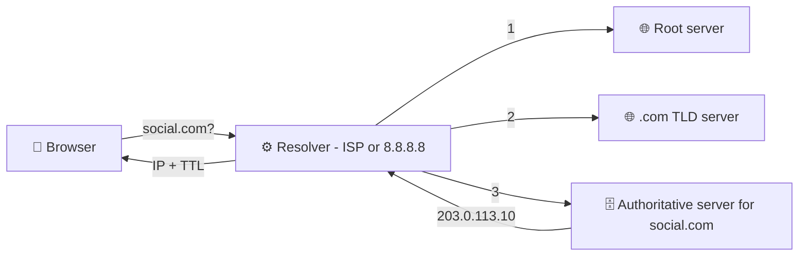

# 05 · DNS

> [!info] Topic info
> **Subject:** System Design · **Chapter:** Networking · **Priority:** 🔥 High · **Status:** ✅ done · **Last reviewed:** 2026-11-19
>
> [← Back to Networking](README.md) · [Interview questions →](questions/networking-qa.md)

> [!abstract] In one line
> **DNS** is the internet's **phone book**: it turns a name like `social.com` into an **IP address**. It's **hierarchical**, **heavily cached** (controlled by **TTL**), and is often the **first step of failover and global load balancing**.

---

## 1. The problem

Users type `social.com`, not `203.0.113.10`. And our IPs change — we add servers, move regions, fail over.

We need a system that maps names to IPs, answers billions of lookups a day, and lets us change the answer without users noticing.

---

## 2. How a lookup works

1. The browser asks a **recursive resolver** (your ISP, or Google `8.8.8.8`, or Cloudflare `1.1.1.1`).
2. The resolver asks a **root server** → "ask the `.com` servers".
3. The **TLD server** → "ask `social.com`'s **authoritative** server".
4. The authoritative server gives the real answer.

A full lookup takes **20–120 ms**. But answers are cached at every step — browser, OS, resolver — so most lookups take **~0 ms**.

DNS normally uses **UDP** on port 53 (small, fast queries), falling back to TCP for large answers.

### Record types you should know

| Record | Maps | Example |
|---|---|---|
| **A / AAAA** | Name → IPv4 / IPv6 | `social.com → 203.0.113.10` |
| **CNAME** | Name → another name | `www.social.com → social.com` |
| **MX** | Domain → mail server | Email routing |
| **NS** | Domain → its authoritative servers | Who owns the zone |
| **TXT** | Free text | Domain verification, SPF |

---

## 3. TTL — the key design knob

Every DNS answer has a **TTL (time to live)**: how many seconds it can be cached.

| TTL | Good | Bad |
|---|---|---|
| **Long** (1 day) | Fewer lookups, faster, cheap | Changes take up to a day to spread |
| **Short** (30–60 s) | Fast failover and changes | More lookups, a bit more latency |

> [!warning] DNS failover isn't instant
> If our main region dies and we switch DNS to the backup, users with cached answers keep hitting the dead IP until TTL expires. Some resolvers and apps **ignore TTL** and cache longer. So DNS failover takes **minutes**, not seconds — pair it with a load balancer or anycast that fails over faster.

> [!tip] Before a migration
> Lower the TTL to 60 s **a day before** the change. Once old long-TTL answers expire, the switch spreads in about a minute.

---

## 4. DNS in system design

- **DNS load balancing** — return several IPs, or different IPs per user, to spread load. See [DNS load balancing](../load-balancing/03-dns-load-balancing.md).
- **GeoDNS / latency routing** — Indian users get the Mumbai IP, US users get Virginia. Lower latency.
- **Health-checked failover** — managed DNS (Route 53, Cloudflare) stops returning unhealthy IPs.
- **Anycast** — the same IP announced from many locations; used by big DNS providers themselves. See [Anycast routing](../load-balancing/04-anycast-routing.md).
- **Service discovery** — internal DNS names like `orders.internal` instead of IPs.

> [!important] DNS is a single point of failure
> If DNS is down, your perfectly healthy app is unreachable. Use a managed provider with anycast, or two providers. See [SPOF](../core-concepts/04-single-point-of-failure.md).

> [!tip] 🎤 Say it like this
> "DNS turns a domain name into an IP. A resolver walks root, TLD and authoritative servers, and the answer is cached everywhere for its TTL. In design, DNS is the first layer of routing — GeoDNS sends users to the nearest region and health checks drop dead regions — but because of caching, DNS failover takes minutes, so I'd keep TTLs short and put a load balancer behind it."

> [!failure] Interview traps
> - Assuming a DNS change takes effect immediately — caching and TTL delay it.
> - Using DNS round-robin as your only load balancer — it can't see server health or load.
> - Forgetting DNS lookup time in latency — first visit pays 20–120 ms.

---

## Summary

- DNS = name → IP, via resolver → root → TLD → authoritative.
- Cached at every level; **TTL** controls how long.
- Short TTL = fast change, more lookups. Long TTL = cheap, slow to change.
- Used for GeoDNS, failover, DNS load balancing, service discovery.

> [!success] Key takeaway
> DNS is your first routing layer, but its caching makes it slow to change — never rely on it alone for fast failover.

More depth: [How the internet works — DNS](../../computer-networks/01-how-the-internet-works.md) · [What happens when you type a URL](../../computer-networks/deep-dives/what-happens-when-you-type-a-url.md)
