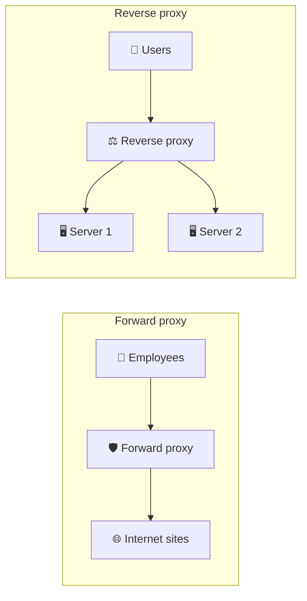
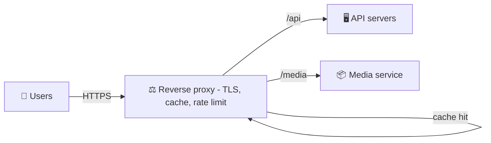

# 06 · Proxy vs Reverse Proxy

> [!info] Topic info
> **Subject:** System Design · **Chapter:** Networking · **Priority:** 🔥 High · **Status:** ✅ done · **Last reviewed:** 2026-11-19
>
> [← Back to Networking](README.md) · [Interview questions →](questions/networking-qa.md)

> [!abstract] In one line
> A **forward proxy** sits in front of **clients** and acts for them; a **reverse proxy** sits in front of **servers** and acts for them — doing **load balancing, TLS termination, caching, compression and security** in one place.

---

## 1. The problem

Our app has 20 API servers. Without anything in front:

- Each server needs its own public IP and TLS certificate.
- Every server must handle gzip, rate limits and static files itself.
- Attackers can hit servers directly.

We want **one front door** that handles all of this. That front door is a reverse proxy.

---

## 2. Forward vs reverse — who does it serve?

| | **Forward proxy** | **Reverse proxy** |
|---|---|---|
| **Sits in front of** | Clients | Servers |
| **Hides** | The client from the server | The servers from the client |
| **Set up by** | Client side — company, user | Server side — us |
| **Used for** | Content filtering, privacy, corporate egress, caching | Load balancing, TLS, caching, security |
| **Examples** | Corporate proxy, VPN-like tools, Squid | Nginx, HAProxy, Envoy, Cloudflare, AWS ALB |

> [!example] Analogy
> **Forward proxy** = your assistant who makes calls for you; the other side doesn't know your number.
> **Reverse proxy** = a company's receptionist; you call one number and they route you to the right person.

---

## 3. What a reverse proxy does for us

- ⚖️ **Load balancing** — spread requests across servers, skip unhealthy ones.
- 🔒 **TLS termination** — decrypt HTTPS once at the edge; servers get plain HTTP. One place to manage certificates.
- ⚡ **Caching** — serve repeated responses (avatars, public posts) without hitting servers.
- 📦 **Compression** — gzip/brotli responses once.
- 🛡️ **Security** — hide server IPs, block bad IPs, rate limit, absorb slow clients, act as a WAF.
- 🔀 **Routing** — `/api` → API servers, `/media` → media service, `v2` → new version (canary).

Config example and Nginx basics: [Production networking](../../computer-networks/08-production-networking.md).

---

## 4. Reverse proxy vs load balancer vs API gateway

They overlap a lot. Simple way to say it:

| | Main job |
|---|---|
| **Reverse proxy** | General front door — any of the jobs above |
| **Load balancer** | A reverse proxy focused on spreading load. Can be L4 or L7. See [Load balancers](../load-balancing/01-load-balancers.md). |
| **API gateway** | A reverse proxy for APIs, plus auth, rate limits, API keys, request shaping. See [API gateway](../microservices-patterns/02-api-gateway.md). |

> [!note] Client IP gets lost
> Behind a proxy, servers see the proxy's IP, not the user's. The proxy adds `X-Forwarded-For` (or `Forwarded`) with the real IP. Only trust it from your own proxies — clients can fake it.

> [!tip] 🎤 Say it like this
> "A forward proxy works for clients — like a corporate proxy that filters outgoing traffic. A reverse proxy works for servers — users hit it, and it forwards to backends. I'd put a reverse proxy like Nginx or Envoy in front of the app to do load balancing, TLS termination, caching and rate limiting in one place, and keep the app servers private."

**✅ Pros:** one entry point, servers stay hidden, central TLS and caching, easy to add servers.
**❌ Cons:** extra hop (~1 ms), can become a **SPOF** or bottleneck — run at least two.

> [!failure] Interview traps
> - Mixing up forward and reverse — ask "who does it act for?".
> - A single reverse proxy in front of everything → new single point of failure. Run a pair with failover. See [SPOF](../core-concepts/04-single-point-of-failure.md).
> - Trusting `X-Forwarded-For` from anyone — attackers spoof it to bypass IP rate limits.

---

## Summary

| Concept | One line |
|---|---|
| **Forward proxy** | Acts for clients, hides them |
| **Reverse proxy** | Acts for servers, hides them |
| **Jobs** | LB, TLS termination, cache, compression, security, routing |
| **Watch out** | SPOF, real client IP, extra hop |

> [!success] Key takeaway
> In almost every design, users hit a reverse proxy / load balancer first — make it redundant and let it do the boring edge work.
