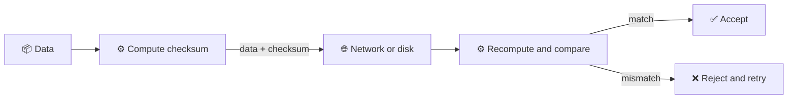

# 07 · Checksums

> [!info] Topic info
> **Subject:** System Design · **Chapter:** Networking · **Priority:** 💤 Low · **Status:** ✅ done · **Last reviewed:** 2026-11-19
>
> [← Back to Networking](README.md) · [Interview questions →](questions/networking-qa.md)

> [!abstract] In one line
> A **checksum** is a small **fingerprint of data** sent or stored with it. The receiver recomputes it — if it doesn't match, the data was **corrupted**.

---

## 1. The problem

A user uploads a 50 MB video. Somewhere between their phone, the network, and our disks, one bit flips. Nobody notices — until the video won't play.

At scale (petabytes, millions of transfers) bit flips are **normal**. We need a cheap way to **detect** them.

---

## 2. How it works

The sender computes a short value from the data and sends both. The receiver does the same calculation. Same result → data is fine.

| Type | Speed | Use |
|---|---|---|
| **Simple sum / Internet checksum** | Fastest, weak | TCP, UDP, IP headers |
| **CRC32** | Very fast, catches burst errors | Ethernet, ZIP, Kafka records, disks |
| **MD5 / SHA-256** | Slower, strong | File downloads, S3 uploads, dedup, Git |

---

## 3. Where you see it in system design

- **Object storage uploads** — client sends an MD5/SHA-256; S3 rejects the upload if it doesn't match.
- **Databases and file systems** — store a checksum per page/block to catch silent disk corruption (HDFS, Cassandra, ZFS).
- **Replication** — compare checksums or hashes of data ranges to find replicas that drifted. [Merkle trees](../data-structures/10-merkle-trees.md) do this at scale.
- **Message queues** — Kafka stores a CRC per record batch.

> [!tip] 🎤 Say it like this
> "A checksum is a small fingerprint of data. The receiver recomputes it and compares — a mismatch means corruption, so we retry or read another replica. TCP has a weak one built in, so for important data like uploads or stored blocks we add a stronger end-to-end checksum like CRC32 or SHA-256."

> [!failure] Interview traps
> - Thinking a checksum gives **security**. CRC and simple sums stop accidents, not attackers. For tamper-proofing use a cryptographic **HMAC** or signature.
> - Relying only on TCP's checksum — it's 16 bits and misses some errors. Check end to end.
> - Confusing **detect** with **fix** — checksums only detect. Fixing needs replicas or [erasure coding](../storage-systems/04-erasure-coding.md).

---

## Summary

- Checksum = fingerprint to **detect** corruption.
- CRC32 for speed, SHA-256 for strength, HMAC for security.
- Used in uploads, storage blocks, replication, queues.

> [!success] Key takeaway
> At scale data corrupts silently — checksum it end to end and recover from a replica.
