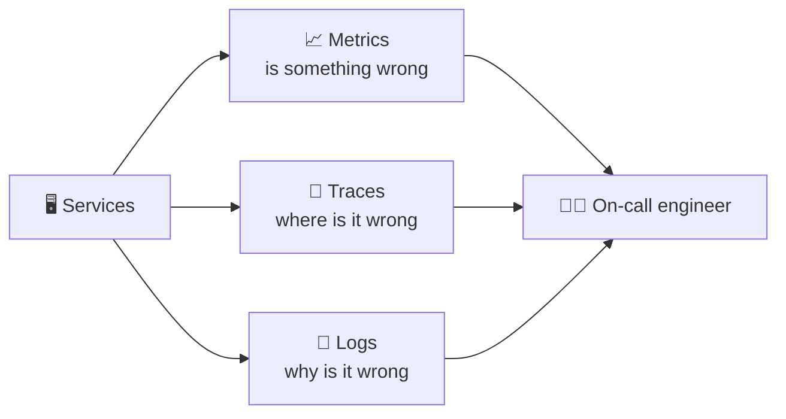

# 01 · The Three Pillars of Observability

> [!info] Topic info
> **Subject:** System Design · **Chapter:** Observability · **Priority:** 🔥 High · **Status:** ✅ done · **Last reviewed:** 2026-11-19
>
> [← Back to Observability](README.md) · [Interview questions →](questions/observability-qa.md)

> [!abstract] In one line
> **Observability** is how well you can understand what's happening **inside** a system from the data it sends **out** — mainly **logs**, **metrics**, and **traces**.

---

## 1. The problem

Our social media app now runs as 20 microservices on 200 servers. At 9 PM, users tweet: *"feed won't load"*.

Which service? Which server? Which users? Is it the database, the cache, or the new deploy from 6 PM? Without data coming out of the system, you're guessing — and every minute of guessing is downtime.

---

## 2. Monitoring vs observability

These words get mixed up. The difference is **known vs unknown** problems.

| | Monitoring | Observability |
|---|---|---|
| **Question** | *Is* something wrong? | *Why* is it wrong? |
| **Works for** | Problems you predicted (known unknowns) | Problems you never saw before (unknown unknowns) |
| **Looks like** | Dashboards + alerts on fixed checks | Free-form digging: filter, group, follow one request |
| **Example** | "Error rate > 1% → page on-call" | "Errors only hit Android users in India on app v5.2" |

Monitoring is a **part** of observability. You monitor to get told; you need observability to find the cause.

> [!tip] 🎤 Say it like this
> "Monitoring tells me *that* something is broken — like the error rate crossing 1%. Observability lets me ask new questions I didn't plan for and find *why*, for example that only one app version in one region is failing. I get there with logs, metrics and traces."

---

## 3. The three pillars

| Pillar | What it is | Good at | Cost |
|---|---|---|---|
| **📈 Metrics** | Numbers over time: req/s, error %, p99 latency | Cheap trends, alerts, dashboards | Low — just numbers |
| **📝 Logs** | Text/JSON records of single events | Full detail of one error | High — huge volume |
| **🧵 Traces** | The path of one request across services, with timings | Finding *which hop* is slow | Medium — usually sampled |

### How they work together — a real debug flow

1. **Metric alert:** feed error rate jumps from 0.1% to 5%. → *Something is wrong.*
2. **Trace:** a slow feed request shows 4.8 s spent in `ranking-service → Redis`. → *Where.*
3. **Logs:** ranking-service logs say `Redis connection pool exhausted`. → *Why.*

The glue is a shared **trace ID** in all three, so you can jump from one to another in a click.

> [!example] Car analogy
> **Metrics** are the dashboard gauges (speed, fuel). **Traces** are the GPS route showing where you got stuck. **Logs** are the mechanic's notes on exactly what broke.

---

## 4. What to measure first

Don't measure everything. Start with what users feel. Two short checklists cover most of it:

- **Four golden signals** (for any service) — **Latency, Traffic, Errors, Saturation**. Already introduced in [Availability](../core-concepts/02-availability.md) (section 14).
- **SLIs and SLOs** — the user-facing targets (e.g. 99.9% of feed loads succeed in < 500 ms). Recap in [Availability](../core-concepts/02-availability.md) (section 3); used for alerting in [Alerts](06-alerts-and-monitoring.md).

> [!note] Events and profiles
> Some people add more pillars: **events** (deploys, config changes) and **continuous profiling** (which code line burns CPU). Nice to mention, but logs/metrics/traces is the standard answer.

---

## 5. OpenTelemetry — one standard for all three

**OpenTelemetry (OTel)** is an open standard + SDKs to collect logs, metrics and traces in one way. You instrument once, then send the data to any backend (Prometheus, Grafana, Datadog, Jaeger…).

It stops **vendor lock-in** — switching tools doesn't mean rewriting instrumentation in 20 services.

**✅ Pros of good observability**
- Lower **MTTR** (mean time to repair) — minutes instead of hours.
- Safer deploys — you see a bad release in seconds.

**❌ Cons**
- Costs real money — log storage often rivals the compute bill.
- Extra CPU/network on every service; needs discipline (naming, IDs, sampling).

> [!failure] Interview traps
> - Saying "observability = dashboards". Dashboards are monitoring; observability is being able to ask *new* questions.
> - Treating the pillars as separate tools with no shared ID — you can't jump from a spike to the guilty request.
> - "Log everything at full detail forever" — costs explode; use sampling and retention.

---

## Summary

| Pillar | Answers | Example |
|---|---|---|
| **Metrics** | Is something wrong? | Error rate 5% |
| **Traces** | Where? | 4.8 s in Redis call |
| **Logs** | Why? | Connection pool exhausted |

> [!success] Key takeaway
> Monitoring tells you *that* it broke; observability tells you *why*. Collect metrics, traces and logs — linked by a trace ID — and alert on what users feel.
