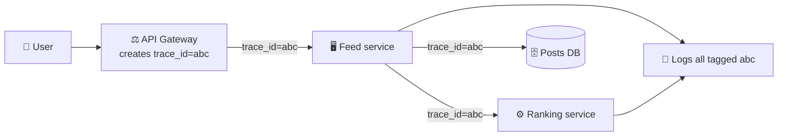

# 02 · Logging

> [!info] Topic info
> **Subject:** System Design · **Chapter:** Observability · **Priority:** 🔥 High · **Status:** ✅ done · **Last reviewed:** 2026-11-19
>
> [← Back to Observability](README.md) · [Interview questions →](questions/observability-qa.md)

> [!abstract] In one line
> A **log** is a timestamped record of one event. Good logs are **structured (JSON)**, have the right **level**, carry a **request/trace ID**, and **never contain secrets or PII**.

---

## 1. The problem

A user says: *"My post failed at 9:02 PM."* You open the logs and find 4 million lines like `Error occurred` with no user, no request, no service name.

Bad logs are worse than no logs — you pay to store them and still can't answer the question.

---

## 2. Structured logs — JSON, not free text

**Unstructured:**
```
2026-11-19 21:02:11 ERROR failed to save post for user 42 after 3 retries
```

**Structured (JSON):**
```json
{"ts":"2026-11-19T21:02:11Z","level":"ERROR","service":"post-service",
 "trace_id":"4bf92f3577b34da6","user_id":42,"event":"post_save_failed",
 "retries":3,"error":"db timeout","duration_ms":3012}
```

With JSON, the log tool can **filter and group** by field: *"all `post_save_failed` in the last hour, grouped by `error`"*. With free text you're stuck writing fragile regex.

> [!tip] 🎤 Say it like this
> "I log in structured JSON with fixed fields — timestamp, level, service, trace ID, and event name — so logs are queryable like a database. Every log line carries the request's trace ID, so I can pull every line for one user request across all services."

---

## 3. Log levels

| Level | When | Example |
|---|---|---|
| **DEBUG** | Developer detail, off in prod | `cache key=feed:42 hit=false` |
| **INFO** | Normal, important business events | `user 42 created post 991` |
| **WARN** | Odd, but handled | `retrying DB call, attempt 2` |
| **ERROR** | A request failed | `post save failed: db timeout` |
| **FATAL** | Process is about to die | `cannot connect to DB at startup` |

Production usually runs at **INFO**. You should be able to switch a service to DEBUG **at runtime** for a few minutes while debugging — without a redeploy.

> [!warning] ERROR should mean "someone should look"
> If ERROR fires 10,000 times a day for expected things (like a 404 or a wrong password), people stop reading it. Expected failures are INFO or WARN.

---

## 4. Correlation / request IDs

One "load feed" click touches 6 services. Each writes its own logs. How do you join them?



- The **edge** (gateway / load balancer) creates a unique ID if the request has none.
- Every service **passes it on** in a header (e.g. `traceparent`, see [Distributed Tracing](05-distributed-tracing.md)) and **adds it to every log line**.
- Search `trace_id=abc` → the full story of one request.

Return the ID to the user too (e.g. in an error page: *"Error ref: abc"*). Support can then find the exact logs.

---

## 5. What NOT to log

- **Secrets:** passwords, API keys, tokens, session cookies, full card numbers.
- **PII** (personally identifiable info): emails, phone numbers, addresses, ID numbers — unless masked (`j***@gmail.com`).
- **Full request/response bodies** — huge and often full of the above.

Logs are copied to many systems and read by many people. A leaked token in logs is a **security breach**, and PII in logs can break laws like **GDPR** (EU privacy law). Add a **redaction** step in the logging library so it's automatic, not a code-review hope.

---

## 6. Volume and cost

At 50,000 req/s with 10 lines per request at ~500 bytes, that's **~20 TB a day**. Storage and indexing bills get huge fast.

How to keep it sane:
- **Right level** — no DEBUG in prod by default.
- **Sampling** — keep 100% of errors, but only 1–10% of successful-request logs.
- **Retention tiers** — hot and searchable for 7–14 days, then cheap archive (S3) for months. See [Log Aggregation](03-log-aggregation.md).
- **Don't log in hot loops** — one line per request, not per item.
- **Async logging** — write to a buffer, not blocking the request.

> [!failure] Interview traps
> - Logging free text with no IDs — impossible to follow a request across services.
> - Logging passwords, tokens or PII "just for debugging".
> - Using logs to count things (e.g. "count login lines"). Counting is the job of **metrics** — far cheaper.
> - Writing logs to local disk only — the server dies, the logs die with it. Ship them off the box.

---

## Summary

- **JSON** structured logs with fixed fields → queryable.
- Correct **levels**; prod at INFO; ERROR means action needed.
- **Trace ID** on every line, passed across services.
- **No secrets/PII** — redact automatically.
- Control cost with **sampling + retention**.

> [!success] Key takeaway
> A log line is useful only if you can **find it** (trace ID + structure) and **afford it** (levels + sampling) — and it must never leak secrets.
