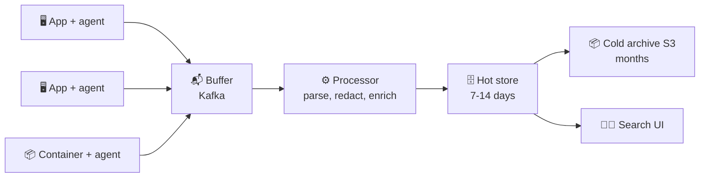

# 03 · Log Aggregation

> [!info] Topic info
> **Subject:** System Design · **Chapter:** Observability · **Priority:** ⚡ Medium · **Status:** ✅ done · **Last reviewed:** 2026-11-19
>
> [← Back to Observability](README.md) · [Interview questions →](questions/observability-qa.md)

> [!abstract] In one line
> **Log aggregation** ships logs from every server into **one central, searchable store**, through **agents → a buffer/pipeline → storage**, with **retention rules** to control cost.

---

## 1. The problem

200 servers, each writing logs to its own disk. To debug one request you'd SSH into 6 machines and `grep`. And with autoscaling, the server that had the error may already be **deleted**.

You need all logs in one place, searchable in seconds, that survive the server dying.

---

## 2. How it works

1. **Agent / shipper** on each host (Fluent Bit, Vector, Filebeat) tails the app's stdout or log files and sends them off. The app just writes to stdout.
2. **Buffer** (Kafka) absorbs spikes. If the store is slow, logs wait in the queue instead of being dropped or slowing the app.
3. **Processor** (Logstash, Vector) parses lines into fields, **redacts** secrets, adds metadata (region, pod, version).
4. **Store + UI** — indexed storage and a search screen.

> [!tip] 🎤 Say it like this
> "Each host runs a lightweight agent that ships logs to a Kafka buffer, so a spike or a slow backend never blocks the app. A processor parses and redacts them, then they land in a searchable store like Elasticsearch or Loki for a week or two, and older logs move to cheap object storage."

---

## 3. Common stacks

| Stack | How it stores | Good | Watch out |
|---|---|---|---|
| **ELK** (Elasticsearch, Logstash, Kibana) | Full-text **indexes every word** | Very fast, flexible search | Index is big and expensive at TB/day |
| **Grafana Loki** | Indexes only **labels** (service, env); raw logs compressed in object storage | Much cheaper | Searching inside text is slower — filter by labels first |
| **Managed** (Datadog, CloudWatch, Splunk) | Vendor handles it | No ops work | Bill grows with volume |

The trade-off is **search speed vs cost**: index everything (ELK) or index little and scan (Loki). See [Full-Text Search](../databases/09-full-text-search.md) for how inverted indexes work.

---

## 4. Retention and cost

Not all logs are worth the same over time:

| Tier | Age | Where | Why |
|---|---|---|---|
| **Hot** | 0–14 days | Indexed store | Active debugging |
| **Cold** | 14 days – 1 year | S3 / Glacier, compressed | Audits, rare investigations |
| **Delete** | After policy | — | Cost + privacy laws |

Audit and security logs (logins, permission changes) often need to be kept longer — a year or more — for compliance.

> [!warning] Back-pressure
> If the log pipeline is down, the agent must **buffer to disk and drop** if full — never block the app. A logging outage must not become a site outage.

**✅ Pros**
- One place to search all services; logs survive dead servers.
- Can join logs from many services by trace ID.

**❌ Cons**
- Expensive at scale — often a top-3 infra cost.
- One more system to run, monitor and scale.

> [!failure] Interview traps
> - Sending logs **directly** from the app to Elasticsearch — a slow cluster then slows your app. Use an agent + buffer.
> - Keeping everything hot forever — the bill explodes.
> - Forgetting clock skew: servers' clocks differ by ms, so order across services by trace/span, not only by timestamp.

---

## Summary

- **Agent → buffer → processor → store → UI.**
- **ELK** = fast search, high cost. **Loki** = label index, cheaper.
- **Hot/cold retention** keeps cost under control.
- Logging must **never block or break** the app.

> [!success] Key takeaway
> Ship logs off the box through a buffered pipeline into one searchable store, and use retention tiers so you only pay "hot" prices for recent logs.
