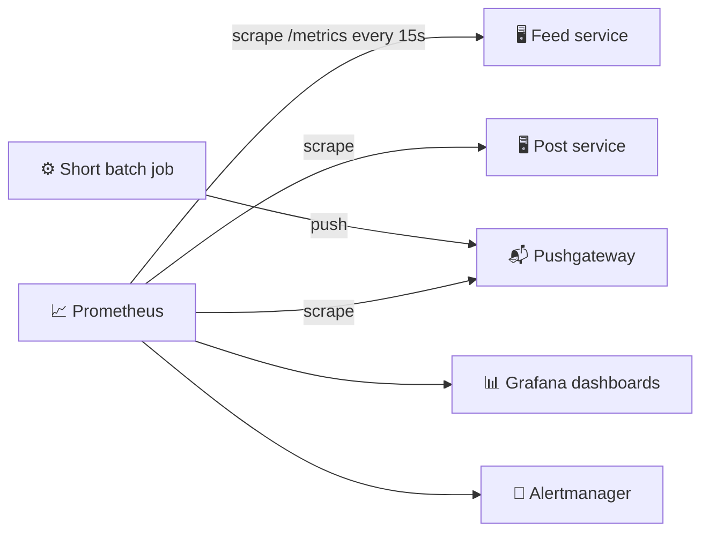

# 04 · Metrics

> [!info] Topic info
> **Subject:** System Design · **Chapter:** Observability · **Priority:** ⚡ Medium · **Status:** ✅ done · **Last reviewed:** 2026-11-19
>
> [← Back to Observability](README.md) · [Interview questions →](questions/observability-qa.md)

> [!abstract] In one line
> **Metrics** are **numbers measured over time** (req/s, error %, p99 latency). They're cheap, great for **dashboards and alerts**, and come in three main types: **counter, gauge, histogram**.

---

## 1. The problem

You want to know: *"What's the error rate of the feed API right now, and was it higher before the deploy?"*

Counting log lines across 20 TB of logs is slow and costly. A metric answers it in milliseconds — it's just one number every 15 seconds.

---

## 2. Metric types

| Type | What it is | Example | Use it for |
|---|---|---|---|
| **Counter** | Only goes **up** (resets on restart) | `http_requests_total` | Rates: req/s, errors/s |
| **Gauge** | Goes **up and down** | `memory_used_bytes`, `queue_length` | Current level |
| **Histogram** | Counts values into **buckets** | `request_duration_seconds` | Percentiles: p50, p99 |

Each metric has **labels** (tags) to slice it: `http_requests_total{service="feed", status="500", region="eu"}`.

> [!note] Why histograms for latency
> An **average** hides pain: 99 requests at 50 ms + 1 at 5 s averages ~100 ms — looks fine. The **p99** shows the 5 s. Use histograms and look at p95/p99. See [Latency, Throughput & Bandwidth](../core-concepts/05-latency-throughput-bandwidth.md).

---

## 3. What to measure — RED and USE

Two easy checklists:

| Method | For | Measure |
|---|---|---|
| **RED** | **Services** (APIs) | **R**ate (req/s), **E**rrors (failed req/s), **D**uration (latency histogram) |
| **USE** | **Resources** (CPU, disk, DB pool) | **U**tilization (% busy), **S**aturation (queue/waiting), **E**rrors |

Plus the **four golden signals** (latency, traffic, errors, saturation) — basically RED + saturation. Recap in [Availability](../core-concepts/02-availability.md) (section 14).

> [!tip] 🎤 Say it like this
> "For every service I track RED — request rate, error rate, and a latency histogram for p99. For resources like CPU, disks and connection pools I use USE — utilization, saturation and errors. Counters for things that only grow, gauges for current levels, histograms for latency."

---

## 4. How metrics are collected — pull vs push

- **Pull (Prometheus):** each service exposes `/metrics`; Prometheus **scrapes** it. Easy to tell if a target is down (scrape fails), and the server controls the load.
- **Push (StatsD, Datadog agent, OTel):** apps send metrics out. Better for **short-lived jobs** and when the collector can't reach the app (behind a firewall).

Metrics are stored in a **time-series database** — see [Time-Series Databases](../databases/11-time-series-databases.md).

---

## 5. The cardinality trap

**Cardinality** = number of unique label combinations. Each combination is a separate time series stored in memory.

- `status` (5 values) × `endpoint` (50) × `region` (4) = **1,000 series**. Fine.
- Add `user_id` (10 million) → **10 billion series**. Prometheus runs out of memory and falls over.

**Rule:** labels must have a **small, bounded** set of values. Never put user IDs, request IDs, emails or full URLs in labels — that's what logs and traces are for.

> [!failure] Interview traps
> - Putting `user_id` or `request_id` as a metric label → **cardinality explosion**.
> - Alerting on **average** latency instead of p99.
> - Calling a counter's raw value useful — you almost always want its **rate** (`rate(http_requests_total[5m])`).
> - Averaging percentiles across servers (p99 of server A + B ÷ 2 is wrong). Merge histogram buckets instead.

---

## Summary

- **Counter** (up only) · **Gauge** (up/down) · **Histogram** (percentiles).
- **RED** for services, **USE** for resources.
- **Pull** (Prometheus) vs **push** (short jobs).
- Keep label **cardinality low**.

> [!success] Key takeaway
> Metrics are the cheap, fast "is something wrong?" signal. Track RED + USE with histograms for latency, and never put unbounded values in labels.
