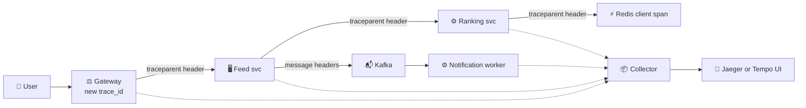

# 05 · Distributed Tracing

> [!info] Topic info
> **Subject:** System Design · **Chapter:** Observability · **Priority:** 🔥 High · **Status:** ✅ done · **Last reviewed:** 2026-11-19
>
> [← Back to Observability](README.md) · [Interview questions →](questions/observability-qa.md)

> [!abstract] In one line
> **Distributed tracing** follows **one request** across all services. A **trace** is made of **spans** (one per step, with timings), linked by a **trace ID** that is **propagated** in request headers.

---

## 1. The problem

Feed load p99 jumped from 300 ms to 2 s. The feed request calls 6 services, a cache and two databases.

Metrics say *it's slow*. Logs from each service look normal on their own. Which of the 9 hops is eating the 1.7 s? You need to see the **whole journey** of one request.

---

## 2. Traces and spans

- **Trace** = the full journey of one request. Has one **trace ID**.
- **Span** = one unit of work inside it: an HTTP call, a DB query, a cache lookup. Has a **span ID**, a **parent span ID**, start time, duration, and tags (`http.status=500`, `db.table=posts`).

Spans form a tree. Shown as a **waterfall** (Gantt chart), the slow part jumps out:

```
GET /feed                 ██████████████████████████████  2000 ms
├─ auth-service           ██                                40 ms
├─ follow-service           ███                             80 ms
├─ ranking-service              ████████████████████████  1700 ms
│  └─ Redis GET                 ███████████████████████   1650 ms  ← here
└─ posts-db query                                    ██    60 ms
```

> [!tip] 🎤 Say it like this
> "A trace is the full path of one request through the system, and each step is a span with its own timing and a pointer to its parent. Looking at the waterfall, I can see straight away which hop is slow or failing — something metrics and per-service logs can't show me."

---

## 3. Context propagation — how the ID travels



1. The first service creates a **trace ID**.
2. Every outgoing call carries it in a header. The standard is **W3C `traceparent`**:
   `traceparent: 00-<trace-id>-<parent-span-id>-01` (the last part says "sampled or not").
3. Each service reads the header, creates its own child span, and passes the context on.
4. Spans are sent **asynchronously** to a **collector**, which stitches them into a trace.

For **queues** (Kafka, SQS), put the context in **message headers** so the trace continues into the async worker.

> [!warning] One broken link breaks the trace
> If one service (or a proxy) drops the header, the trace splits into two unrelated pieces. Every hop must propagate — that's why we use shared libraries, not hand-written code.

---

## 4. OpenTelemetry

**OpenTelemetry (OTel)** is the standard SDK + protocol for traces (and metrics/logs). It gives:
- **Auto-instrumentation** for common HTTP clients, DB drivers and frameworks — spans with little code.
- Standard `traceparent` propagation.
- An **OTel Collector** that can batch, sample and forward to any backend (Jaeger, Grafana Tempo, Datadog, Honeycomb).

A **service mesh** sidecar can also create spans per hop — see [Service Mesh](../microservices-patterns/08-service-mesh.md) — but the app still has to forward the header.

---

## 5. Sampling — you can't keep every trace

At 50,000 req/s with ~20 spans each, that's 1 million spans/second. Too expensive to store all.

| | Head-based sampling | Tail-based sampling |
|---|---|---|
| **Decided** | At the **start** of the request | **After** the whole trace finishes |
| **How** | Keep e.g. 1% at random; decision passed in `traceparent` | Collector buffers all spans, then decides |
| **Keeps errors?** | ❌ Only by luck — 1% of errors | ✅ Keep 100% of errors and slow traces |
| **Cost** | Cheap, simple | Collector needs memory to hold traces for seconds |

Common mix: low head sampling for normal traffic + **tail sampling** to keep every error and every request above, say, 1 s.

**✅ Pros**
- Shows exactly *where* time goes across services.
- Reveals hidden dependencies and bad patterns (N+1 calls, serial calls that could be parallel).

**❌ Cons**
- Every service must be instrumented and propagate context.
- Storage cost; sampling means the one trace you want may be missing.

> [!failure] Interview traps
> - Thinking tracing replaces logs — traces show *where*, logs still explain *why*.
> - Using only 1% head sampling and then "we never have traces of the errors".
> - Forgetting async hops (queues, cron jobs) — the trace stops at the queue.
> - Adding trace ID as a **metric label** — cardinality explosion. Link metrics to traces with **exemplars** instead (a sample trace ID attached to a histogram bucket).

---

## Summary

- **Trace** = one request; **span** = one step with timing and parent.
- **Propagate** context via W3C `traceparent` (and message headers for queues).
- **OpenTelemetry** = standard SDK; send to Jaeger/Tempo/etc.
- **Head** sampling is cheap; **tail** sampling keeps errors and slow requests.

> [!success] Key takeaway
> In microservices, tracing is how you find *which hop* is slow. Propagate the trace context everywhere, and use tail sampling so the interesting traces are never thrown away.
