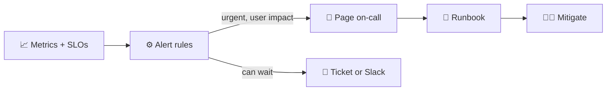

# 06 · Alerts and Monitoring

> [!info] Topic info
> **Subject:** System Design · **Chapter:** Observability · **Priority:** ⚡ Medium · **Status:** ✅ done · **Last reviewed:** 2026-11-19
>
> [← Back to Observability](README.md) · [Interview questions →](questions/observability-qa.md)

> [!abstract] In one line
> Good alerts fire on **user-facing symptoms** tied to **SLOs**, use **burn-rate** math, and only **page** a human when action is needed **now** — everything else is a **ticket**.

---

## 1. The problem

The on-call engineer for our social app gets **200 alerts a night**: CPU 85%, disk 70%, one pod restarted… 95% need no action.

After a week they mute the channel. Then the real outage — feed down for 40 minutes — goes unnoticed. That's **alert fatigue**.

---

## 2. Symptoms vs causes

| | Symptom-based | Cause-based |
|---|---|---|
| **Alerts on** | What users feel | Internal guesses |
| **Example** | "2% of feed loads failing" | "CPU at 90% on node-17" |
| **Problem** | — | CPU 90% may be totally fine; and misses causes you didn't predict |

**Page on symptoms.** Causes (CPU, disk) belong on dashboards or as low-priority tickets — except things that will **certainly** become an outage soon (disk 95% and filling fast).

> [!tip] 🎤 Say it like this
> "I page on symptoms users feel — error rate and latency against the SLO — not on CPU or memory. Causes go on dashboards for debugging. Every page must be urgent, actionable and have a runbook; if nobody needs to act right now, it's a ticket, not a page."

---

## 3. SLO burn-rate alerts

Quick recap: an **SLO** of 99.9% success over 30 days gives an **error budget** of 0.1% (~43 min). Details in [Availability](../core-concepts/02-availability.md) (section 3).

**Burn rate** = how fast you're spending the budget. Burn rate 1 = you'd use exactly 100% in 30 days.

| Burn rate | Budget gone in | Action |
|---|---|---|
| **14×** over 1 h | ~2 days | 🚨 **Page** now |
| **6×** over 6 h | ~5 days | 🚨 Page |
| **1×** over 3 days | 30 days | 🎫 Ticket |

Why not just "error rate > 1%"? Fixed thresholds either fire on short blips or miss slow leaks. Burn rate ties the alert to **real user impact on your promise**. Using a long **and** short window together (e.g. 1 h and 5 min) means the alert also **clears quickly** once fixed.

---

## 4. Paging vs ticket — the routing

A good page is:
- **Urgent** — users are hurting now or very soon.
- **Actionable** — a human can do something.
- **Has a runbook link** — see [Dashboards & Runbooks](07-dashboards-and-runbooks.md).

Also add **synthetic checks** (a bot that loads the feed every minute from outside) and **dead-man's-switch** alerts (fire if a heartbeat or cron job *stops* reporting) — they catch "the monitoring itself is down".

> [!warning] Fighting alert fatigue
> - Review every page weekly: no action taken → delete or downgrade it.
> - Group related alerts (one page for "region down", not 300).
> - Add a "for 5 minutes" wait to skip blips.
> - Target: a few pages per on-call shift, not dozens.

> [!failure] Interview traps
> - Paging on CPU/memory thresholds instead of user symptoms.
> - Alerting on average latency — use p99 against the SLO.
> - Monitoring from inside only — if the whole region is down, your in-region alerting is down too. Have an **external** check.

---

## Summary

- **Page on symptoms**, dashboard the causes.
- **SLO burn-rate** alerts with multiple windows.
- **Page** = urgent + actionable + runbook; else **ticket**.
- Fight **alert fatigue** by pruning noisy alerts.

> [!success] Key takeaway
> Few, meaningful pages tied to the SLO beat hundreds of CPU alerts. If a page needs no action, it shouldn't be a page.
