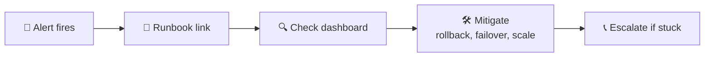

# 07 · Dashboards and Runbooks

> [!info] Topic info
> **Subject:** System Design · **Chapter:** Observability · **Priority:** 💤 Low · **Status:** ✅ done · **Last reviewed:** 2026-11-19
>
> [← Back to Observability](README.md) · [Interview questions →](questions/observability-qa.md)

> [!abstract] In one line
> **Dashboards** show system health at a glance; **runbooks** are step-by-step guides that tell the on-call engineer **what to do** when a specific alert fires.

---

## 1. The problem

It's 3 AM. The alert says *"Feed SLO burn rate high"*. The on-call engineer joined 2 weeks ago and has never touched the feed service.

Where to look? What to try first? Who to call? Without a dashboard and a runbook, they lose 30 minutes just getting oriented.

---

## 2. Dashboards

A good dashboard answers **"is it healthy, and if not, where?"** in 10 seconds.

- **Top row:** SLO status + RED for the service (req/s, error %, p99 latency).
- **Next:** dependencies (DB, cache, queue lag) and resources (USE: CPU, memory, pool usage).
- **Overlay deploys** as markers — most incidents start right after a change.
- Same layout for every service, so anyone can read any dashboard.

> [!warning] Dashboard sprawl
> 400 dashboards with 50 graphs each = nobody knows which one matters. Keep one **service overview** per service and a few top-level ones. Dashboards are for **diagnosing**, not for staring at — alerts tell you when to look.

---

## 3. Runbooks

**What goes in a runbook:**
- **What the alert means** and the user impact.
- **Links:** dashboard, logs query, traces.
- **Checks:** "Was there a deploy in the last hour? Is Redis latency high?"
- **Mitigation steps:** roll back, fail over, scale up, turn off a feature flag — with exact commands.
- **Escalation:** who owns it, who to call next.

Mitigate first, debug later. Steps that are always the same should become **automation** (one-click rollback) — the runbook then just says "press this".

> [!tip] 🎤 Say it like this
> "Every page links to a runbook: what the alert means, the dashboard and log links, quick checks like recent deploys, and safe mitigation steps such as rollback or failover. The goal is that any on-call engineer can stop the bleeding in minutes, even if they don't know the service."

> [!failure] Interview traps
> - Out-of-date runbooks — update them after every incident (part of the **post-mortem**).
> - Runbooks that say "investigate the issue" — they must have concrete steps.

---

## Summary

- **Dashboards:** RED + SLO on top, dependencies below, deploy markers, same layout everywhere.
- **Runbooks:** meaning, links, checks, mitigation, escalation.
- Repeated steps → **automate**.

> [!success] Key takeaway
> Alerts say *when* to act, dashboards show *where*, runbooks say *what to do* — together they cut MTTR.
