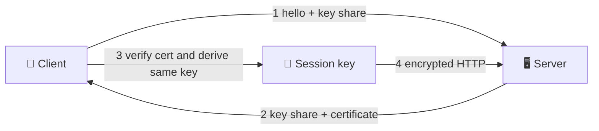
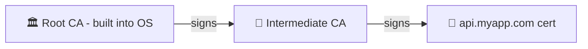

# 01 · SSL / TLS

> [!info] Topic info
> **Subject:** System Design · **Chapter:** Security · **Priority:** 🔥 High · **Status:** ✅ done · **Last reviewed:** 2026-11-19
>
> [← Back to Security](README.md) · [Interview questions →](questions/security-qa.md)

> [!abstract] In one line
> **TLS** (the modern name for SSL) protects **data in transit**: it **encrypts** traffic, proves the server's **identity** with a **certificate**, and detects **tampering**.

---

## 1. The problem

A user of our social media app logs in from café Wi-Fi. Without encryption, anyone on that network can read the password and the session cookie in plain text — and even change the response.

Inside our data center it's the same story: traffic between services crosses shared networks. We need data to be **private, untampered, and sent to the right server**.

> [!note] SSL vs TLS
> **SSL** is the old, broken protocol. Everything today runs **TLS 1.2 or 1.3**. People still say "SSL certificate" out of habit — it means a TLS certificate.

---

## 2. How it works

TLS gives three guarantees:

- 🔒 **Encryption** — nobody in the middle can read the data.
- ✅ **Integrity** — any change on the way is detected.
- 🪪 **Authentication** — the certificate proves "I really am `api.myapp.com`".

The trick: **asymmetric** crypto (public/private key, slow) is used only in the handshake to agree on a **symmetric** session key (one shared key, fast, e.g. AES). All real data then uses the fast key.

### The handshake — intuition only

1. Client says hello, lists ciphers it supports, and sends its half of a **key exchange** (Diffie-Hellman).
2. Server replies with its half plus its **certificate**.
3. Both sides compute the **same session key** — the key itself never travels on the wire.
4. Encrypted data starts flowing.

**TLS 1.3 = 1 round trip** (TLS 1.2 needed 2). On a 100 ms link that saves ~100 ms on every new connection. Resumed sessions can even send data with **0-RTT**.

Full handshake walkthrough → [HTTP and HTTPS](../../computer-networks/02-http-and-https.md).

> [!tip] 🎤 Say it like this
> "TLS uses asymmetric crypto only during the handshake to agree on a symmetric key, then encrypts everything with that fast key. The certificate proves the server's identity. TLS 1.3 does the handshake in one round trip, so the cost is small — the bigger cost is new connections, which is why we reuse them."

---

## 3. Certificates and the CA chain

A **certificate** says: "this public key belongs to `api.myapp.com`, valid until March", signed by a **Certificate Authority (CA)** — a trusted company like Let's Encrypt or DigiCert.

The client checks: is the chain signed by a root it trusts? Does the name match? Is it not expired?

> [!warning] Expired certs cause real outages
> A forgotten certificate expiring is one of the most common causes of "everything is down". Automate renewal (Let's Encrypt certs last 90 days) and alert well before expiry.

---

## 4. Where to terminate TLS

**TLS termination** = the place where traffic is decrypted. This is the real system-design question.

| Option | How | Trade-off |
|---|---|---|
| **Terminate at LB** | LB decrypts, sends plain HTTP inside | Simple, certs in one place, LB can route on URL/headers. Traffic inside is unencrypted. |
| **Re-encrypt** | LB decrypts, inspects, opens new TLS to backend | Inspection + encryption inside. Extra CPU, certs on every backend. |
| **Passthrough** | LB forwards encrypted bytes, backend decrypts | True end-to-end. LB can't see HTTP, so only L4 routing. |

Most companies terminate at the LB or API gateway for the public edge, then use **mTLS** inside (zero trust: "don't trust the internal network").

### mTLS — mutual TLS

In normal TLS only the **server** shows a certificate. In **mTLS** the **client also shows one**, so both sides prove who they are.

Used **service-to-service**: the Payments service only accepts calls from services with a valid cert. A **service mesh** (Istio, Linkerd) does this automatically via sidecars and rotates certs every few hours — see [Service Mesh](../microservices-patterns/08-service-mesh.md).

**✅ Pros of TLS everywhere**
- Protects against sniffing and tampering, even inside the network.
- Required by compliance (PCI-DSS, HIPAA).

**❌ Cons**
- Handshake adds latency on new connections — fix with keep-alive and connection reuse.
- Certificate management: issuing, rotating, expiry monitoring.

> [!failure] Interview traps
> - Saying "TLS uses RSA to encrypt the data" — the **data** uses a **symmetric** key; asymmetric is only for the handshake.
> - Thinking HTTPS hides everything — the **domain name** and IP are still visible to the network.
> - Forgetting that terminating at the LB leaves **internal traffic in plain text**.
> - TLS protects data **in transit** only — data on disk needs [encryption at rest](02-encryption-at-rest.md).

---

## Summary

| Idea | Remember |
|---|---|
| **TLS** | Encryption + integrity + server identity for data in transit |
| **Handshake** | Asymmetric to agree a key, symmetric for data. TLS 1.3 = 1 RTT |
| **Certificate** | Public key + domain, signed through a CA chain |
| **Termination** | At LB = simple; re-encrypt or passthrough = end-to-end |
| **mTLS** | Both sides show certs — standard for service-to-service |

> [!success] Key takeaway
> Terminate TLS at the edge for simplicity, use mTLS between services for zero trust, and **automate certificate renewal** so it never expires on you.
