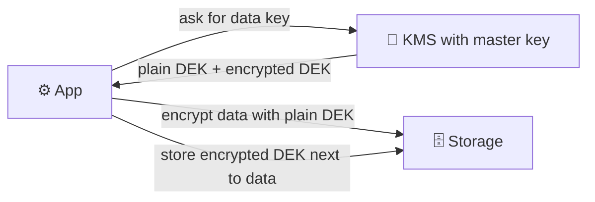

# 02 · Encryption at Rest

> [!info] Topic info
> **Subject:** System Design · **Chapter:** Security · **Priority:** ⚡ Medium · **Status:** ✅ done · **Last reviewed:** 2026-11-19
>
> [← Back to Security](README.md) · [Interview questions →](questions/security-qa.md)

> [!abstract] In one line
> **Encryption at rest** protects **stored data** — disks, databases, backups — so a stolen disk or leaked snapshot is useless without the **key**, which lives in a **KMS**.

---

## 1. The problem

[TLS](01-ssl-tls.md) protects data while it moves. But our social media app also **stores** 50 TB of messages, photos, and emails.

What if an old disk is thrown away, a DB backup lands in a public S3 bucket, or a cloud employee looks at raw storage? Without encryption at rest, all of it is readable.

---

## 2. Three layers of encryption

| Layer | What it protects against | What it does NOT protect against |
|---|---|---|
| **Disk / volume** (EBS, S3 server-side) | Stolen disks, lost backups | Anyone who can query the DB or app |
| **Database - TDE** (Transparent Data Encryption) | Someone copying raw DB files | A DB user with SELECT access |
| **Application / field-level** | DB admins, SQL injection dumps, leaked DB | Bugs in the app itself, which holds the key |

The higher you go, the more you protect — and the more it costs. With field-level encryption the DB only sees gibberish, so you **can't search, sort, or index** that column easily.

> [!tip] 🎤 Say it like this
> "I'd turn on disk and database encryption everywhere — it's almost free in the cloud. For really sensitive fields like card numbers or national IDs, I'd add application-level encryption, so even a DB admin or a leaked dump only sees ciphertext. Keys live in a KMS, never next to the data."

---

## 3. Envelope encryption with a KMS

Where do the keys go? Not in the same database — that's like taping the key to the lock.

A **KMS** (Key Management Service, e.g. AWS KMS, Google Cloud KMS) holds a **master key** that **never leaves** it. We use two levels of keys:

- **Data key (DEK)** — encrypts the actual data. Fast, local.
- **Master key (KEK)** — inside the KMS, only used to encrypt the data keys.

To read: send the **encrypted DEK** to KMS, get the plain DEK back, decrypt locally, then throw the plain DEK away from memory.

**Why this design?**
- Big data never goes to the KMS — only a 32-byte key. Fast and cheap.
- **Rotating the master key** only re-encrypts small data keys, not 50 TB of data.
- KMS logs every key use — great for audits. Revoke KMS access and the data is dead.

> [!failure] Interview traps
> - Storing the encryption key in the same DB or config file as the data.
> - Thinking disk encryption stops a hacker who got into the app — the app sees plain data.
> - Encrypting a field you need to search on without a plan — use a **blind index** (a hash of the value) for exact-match lookups.
> - Forgetting **backups and logs** — they leak just as easily.

---

## Summary

- **Disk / TDE** — cheap baseline, protects against stolen media.
- **Field-level** — protects sensitive fields even from DB access, but hurts querying.
- **Envelope encryption** — data key encrypts data, KMS master key encrypts data keys.
- Rotation and audit come almost free with a KMS.

> [!success] Key takeaway
> Encrypt everything at rest by default, add field-level encryption for the crown jewels, and keep keys in a **KMS** — never next to the data.
