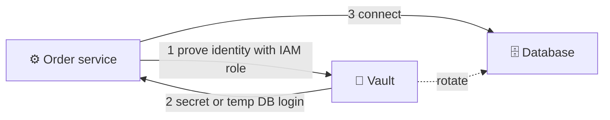

# 03 · Secrets Management

> [!info] Topic info
> **Subject:** System Design · **Chapter:** Security · **Priority:** ⚡ Medium · **Status:** ✅ done · **Last reviewed:** 2026-11-19
>
> [← Back to Security](README.md) · [Interview questions →](questions/security-qa.md)

> [!abstract] In one line
> **Secrets management** means keeping passwords, API keys and tokens in a **central vault**, giving them only to the services that need them, **rotating** them, and preferring **short-lived credentials**.

---

## 1. The problem

Our app has 40 microservices. Each needs secrets: DB passwords, the Stripe API key, the JWT signing key.

A developer pastes the DB password into `config.py` and pushes to GitHub. Bots scan public repos and find leaked keys **within minutes**. Even in a private repo, every engineer and every CI log now has production access.

> [!warning] Deleting the commit is not enough
> Git history, forks and clones keep the secret forever. A leaked secret must be **rotated** (replaced) immediately.

---

## 2. How it works

A **secrets manager** (HashiCorp Vault, AWS Secrets Manager, GCP Secret Manager) is a locked store for secrets. It is encrypted with a KMS ([envelope encryption](02-encryption-at-rest.md)), and every read is logged.

1. The service proves **who it is** using its platform identity (IAM role, Kubernetes service account) — no password needed to get passwords.
2. Vault checks the policy: "Order service may read `db/orders`" and returns only that.
3. The service uses it, ideally fetching at runtime instead of baking it into images.

### Short-lived (dynamic) credentials

Even better than a stored password: Vault **creates a fresh DB user** on request that expires in 1 hour. If it leaks, it's useless soon. Same idea as cloud **IAM roles** giving temporary tokens instead of long-lived access keys.

### Rotation

Change secrets on a schedule (e.g. every 30–90 days) and instantly after a leak. Support **two valid versions** during the switch so services don't break mid-rotation.

> [!tip] 🎤 Say it like this
> "Secrets never go in code or in env files in git. I keep them in a secrets manager like Vault or AWS Secrets Manager, and each service gets only the secrets it needs, based on its IAM identity. Wherever possible I use short-lived dynamic credentials and automatic rotation, so a leak has a small blast radius."

**✅ Pros**
- One place to audit, rotate, and revoke.
- Least privilege per service.

**❌ Cons**
- The vault becomes critical — if it's down, services can't start. Run it HA and cache secrets briefly.

> [!failure] Interview traps
> - "We use env vars, so it's secure" — env vars are fine for **delivery** at runtime, but the values must come from a vault, not a `.env` file in git.
> - Same secret shared by all services and all environments (dev = prod).
> - Logging config or request headers that contain secrets.
> - Putting backend keys in frontend code — anything shipped to the browser is public.

---

## Summary

- Never in code or git — use a **vault / secrets manager**.
- Services authenticate with their **identity**, get only **their** secrets.
- Prefer **short-lived** credentials; **rotate** the rest.
- Leak = rotate now, not just delete.

> [!success] Key takeaway
> A good secret is one that is **centrally stored, narrowly scoped, short-lived, and audited**.

More on env vars for app developers → [Auth and Security](../../computer-networks/06-auth-and-security.md).
