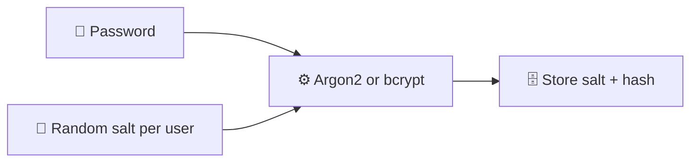

# 04 · Password Storage

> [!info] Topic info
> **Subject:** System Design · **Chapter:** Security · **Priority:** ⚡ Medium · **Status:** ✅ done · **Last reviewed:** 2026-11-19
>
> [← Back to Security](README.md) · [Interview questions →](questions/security-qa.md)

> [!abstract] In one line
> Store passwords with a **slow, salted, one-way hash** (**Argon2**, **bcrypt**, **scrypt**) — never plain text, never encryption, never a fast hash like SHA-256.

---

## 1. The problem

Our app has 10 million users. One day the `users` table leaks — it happens to big companies every year.

If passwords are plain text, attackers log in as everyone, and also try those passwords on Gmail and banks (people reuse passwords). Our goal: **even with the full DB, attackers can't get the passwords back**.

---

## 2. Hashing, not encryption

- **Encryption** is two-way: with the key you get the password back. If the key leaks with the DB, everything is exposed.
- **Hashing** is one-way: `hash(password)` can't be reversed. At login we hash what the user typed and **compare** the hashes.

We never need the real password back, so we never store it in a reversible form.

---

## 3. Salt, slow hash, pepper

**Salt** — a random value per user, stored next to the hash. Two users with `password123` get **different** hashes, so precomputed tables (**rainbow tables**) are useless and each password must be cracked separately.

**Slow hash** — SHA-256 is built to be fast: a GPU does **billions per second**, so an 8-character password falls in hours. **bcrypt / scrypt / Argon2** are tuned to take ~100–300 ms each — fine for one login, terrible for billions of guesses. scrypt and Argon2 also need lots of **memory**, which kills GPU attacks. Argon2id is today's first choice.

**Pepper** — an extra secret added to every password, kept **outside** the DB (in a vault or HSM). If only the DB leaks, the hashes can't even be attacked.

> [!tip] 🎤 Say it like this
> "Passwords must be hashed, not encrypted, because we never need them back. I'd use Argon2id or bcrypt with a unique salt per user — the salt defeats rainbow tables and the slowness makes brute force expensive. Optionally a pepper stored in a vault adds protection if only the database leaks."

> [!note] Slow on purpose = a cost
> 200 ms of CPU per login adds up at 5,000 logins/sec. Run auth on its own scaled service and add **rate limiting** on login to stop online guessing.

> [!failure] Interview traps
> - "I'll use SHA-256 with a salt" — salt helps, but it's still **too fast**.
> - Using one global salt for everyone — salts must be **per user**.
> - Writing your own crypto — use a standard library.
> - Forgetting to **re-hash** old weak hashes: upgrade a user's hash the next time they log in successfully.

---

## Summary

| Rule | Why |
|---|---|
| **Hash, don't encrypt** | No key to steal, can't be reversed |
| **Unique salt per user** | Kills rainbow tables, same passwords look different |
| **Slow hash - Argon2id / bcrypt** | Makes brute force billions of times slower |
| **Pepper in a vault** | Protects hashes if only the DB leaks |

> [!success] Key takeaway
> Leaked DB ≠ leaked passwords — if you used a **slow, salted hash**.

Code example for developers → [Auth and Security](../../computer-networks/06-auth-and-security.md).
