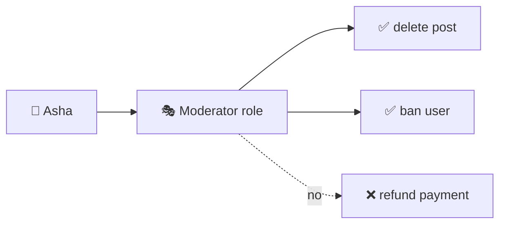

# 05 · RBAC (Role-Based Access Control)

> [!info] Topic info
> **Subject:** System Design · **Chapter:** Security · **Priority:** ⚡ Medium · **Status:** ✅ done · **Last reviewed:** 2026-11-19
>
> [← Back to Security](README.md) · [Interview questions →](questions/security-qa.md)

> [!abstract] In one line
> **RBAC** gives permissions to **roles** (admin, moderator, viewer) and roles to **users**, so access is managed in a few roles instead of millions of user-by-user rules.

---

## 1. The problem

Authentication tells us **who** you are. Authorization decides **what you may do** — recap in [Authentication vs Authorization](../api-fundamentals/09-authentication-vs-authorization.md).

Our app now has an internal admin panel used by 300 staff. Giving each person their own list of permissions is a mess: someone changes team and keeps old powers forever.

---

## 2. How RBAC works

- **Permission** = an action on a resource: `post:delete`, `user:ban`.
- **Role** = a named bundle of permissions: `moderator`.
- **User** gets one or more roles.

When Asha moves to Support, we swap her role — one change, all permissions follow. At request time the API (or [API gateway](../microservices-patterns/02-api-gateway.md)) checks: "does any of her roles have `post:delete`?" Roles are often put inside the [JWT](../api-fundamentals/11-jwt.md) so services can check without a DB call.

> [!tip] 🎤 Say it like this
> "Authorization decides what a logged-in user can do. With RBAC I group permissions into roles like admin, editor, viewer, and assign roles to users. It's simple and easy to audit. When rules depend on context — like 'only the owner can edit' or 'only during work hours' — I add attribute checks, which is ABAC."

---

## 3. RBAC vs ABAC vs ACL

| Model | Rule looks like | Good for | Weak spot |
|---|---|---|---|
| **ACL** (Access Control List) | "File X: Asha can read, Ravi can write" | Per-object sharing, like Google Docs | Hard to manage at scale |
| **RBAC** | "Moderators can delete posts" | Company roles, admin panels | **Role explosion** — `editor-india-weekend`… |
| **ABAC** (Attribute-Based) | "User can edit post if user.id == post.ownerId" | Fine-grained, context rules | Harder to audit and debug |

Real systems mix them: RBAC for the big picture, ownership/attribute checks for "your own post", ACLs for sharing.

> [!important] Least privilege
> Give every user and every service the **minimum** access it needs, for the **shortest** time. Default is deny. Review roles regularly and remove what's unused.

> [!failure] Interview traps
> - Checking permissions only in the **frontend** — hiding a button isn't security; always check on the server.
> - Creating a new role for every special case — that's role explosion; use attributes instead.
> - Long-lived roles in JWTs — a removed admin keeps access until the token expires. Keep tokens short-lived.

---

## Summary

- **Authorization** = what you can do; RBAC is the most common model.
- **User → Role → Permission**; change the role, not each user.
- **ABAC** for context rules, **ACL** for per-object sharing.
- Always enforce on the server, with **least privilege**.

> [!success] Key takeaway
> Start with RBAC for simplicity, add ABAC checks like ownership where roles aren't enough, and default to **deny**.
