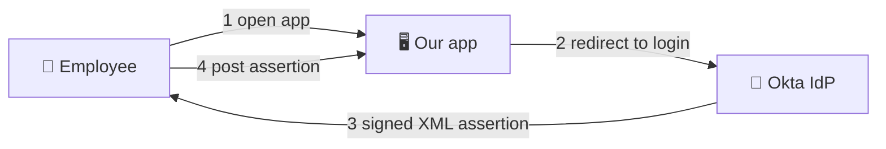

# 06 · SAML

> [!info] Topic info
> **Subject:** System Design · **Chapter:** Security · **Priority:** 💤 Low · **Status:** ✅ done · **Last reviewed:** 2026-11-19
>
> [← Back to Security](README.md) · [Interview questions →](questions/security-qa.md)

> [!abstract] In one line
> **SAML** is an older, **XML-based** standard for **enterprise SSO**: the company's identity provider signs an "assertion" saying who the user is, and the app trusts it.

---

## 1. The problem

A big company buys our app for 5,000 employees. They don't want 5,000 new passwords — they want staff to log in with their **company account** (Okta, Azure AD), and to cut access instantly when someone leaves.

That's **SSO** (single sign-on) — see [SSO](../api-fundamentals/13-sso.md). In enterprises, SSO very often means SAML.

---

## 2. How it works

Two players:
- **IdP** (Identity Provider) — the company login system, e.g. Okta.
- **SP** (Service Provider) — our app.

1. The user opens our app; we don't know them, so we redirect to the company IdP.
2. They log in there (password + MFA).
3. The IdP returns a **signed XML assertion**: "this is asha@corp.com, groups: finance".
4. The browser posts it to us. We **verify the signature** with the IdP's public cert and log the user in.

The trust is set up once, beforehand, by exchanging metadata (URLs and certificates).

> [!tip] 🎤 Say it like this
> "SAML is XML-based SSO, mostly for enterprises. Our app redirects to the company's identity provider, the user logs in there, and the IdP sends back a signed assertion that we verify. For new apps I'd prefer OpenID Connect, which is JSON and JWT-based and works well for mobile and APIs, but we support SAML because enterprise customers ask for it."

---

## 3. SAML vs OIDC

| | **SAML 2.0** | **OIDC** (OpenID Connect) |
|---|---|---|
| **Format** | XML assertions | JSON / [JWT](../api-fundamentals/11-jwt.md) ID tokens |
| **Built on** | Its own standard | [OAuth 2.0](../api-fundamentals/12-oauth2.md) |
| **Best for** | Enterprise web SSO | Modern web, mobile, APIs, "Login with Google" |
| **Complexity** | Heavy, tricky XML signing | Lighter, easier libraries |

> [!failure] Interview traps
> - Calling SAML an authorization protocol — it's about **authentication** (who you are), plus some attributes.
> - Not validating the signature, audience and expiry of the assertion — classic SAML vulnerabilities.
> - Confusing OAuth 2.0 (delegated access) with SSO — OIDC adds the identity layer on top.

---

## Summary

- SAML = **XML, signed assertions, enterprise SSO**.
- **IdP** logs the user in, **SP** trusts the signed assertion.
- New builds → **OIDC**; support SAML for enterprise customers.

> [!success] Key takeaway
> Know the flow (redirect → IdP login → signed assertion → verify) and when you'd choose OIDC instead.
