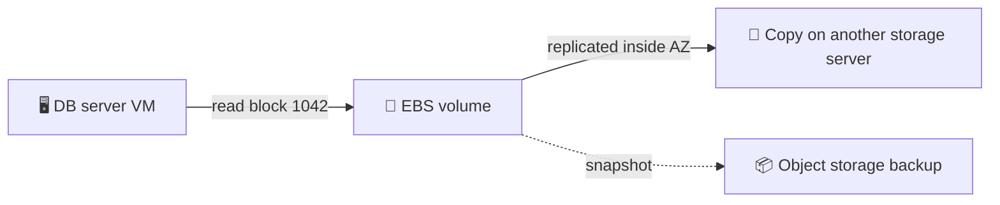

# 01 · Block Storage

> [!info] Topic info
> **Subject:** System Design · **Chapter:** Storage Systems · **Priority:** ⚡ Medium · **Status:** ✅ done · **Last reviewed:** 2026-11-19
>
> [← Back to Storage Systems](README.md) · [Interview questions →](questions/storage-systems-qa.md)

> [!abstract] In one line
> **Block storage** is a raw **virtual disk** split into fixed-size **blocks**, **attached to one server**, giving the **lowest latency** and highest **IOPS** — the right home for **databases** and OS disks.

---

## 1. The problem

Our social media app runs PostgreSQL on a cloud VM. The database needs a disk that is **fast** (thousands of small random reads/writes per second) and **survives** if the VM dies.

The VM's local disk is fast but disappears with the VM. We need a disk that lives **separately** from the server but still feels local.

---

## 2. How it works

The disk is cut into **blocks** (e.g. 4 KB each), each with an address. The storage system knows nothing about files — it just reads and writes block numbers.

The server's OS puts a **file system** (ext4, NTFS) on top, so the app sees normal files. In the cloud, the "disk" is actually on storage servers, reached over a fast network — e.g. **AWS EBS** (Elastic Block Store).

**Key ideas:**
- **Attached to one VM at a time** (mostly). Like a hard drive — you plug it into one machine.
- Lives in **one availability zone** (one data center). To survive an AZ outage, use **snapshots** or DB replication.
- If the VM dies, you **detach** the volume and attach it to a new VM — data is still there.

---

## 3. Performance: IOPS, throughput, latency

| Metric | Meaning | Who cares |
|---|---|---|
| **IOPS** | Read/write operations per second | Databases (many small random reads) |
| **Throughput** | MB/s moved | Big sequential reads — logs, analytics |
| **Latency** | Time per operation, ~1 ms or less on SSD | Everything user-facing |

You **pick and pay** for these. An SSD volume with 16,000 provisioned IOPS costs more than a cheap HDD volume tuned for throughput.

> [!note] Local NVMe vs network block storage
> Local instance disks are even faster (micro-seconds), but data is **lost** when the VM stops. Use them for caches or temp data, or for databases that replicate themselves (Cassandra, Kafka).

---

## 4. Block vs file vs object storage

This is the comparison interviewers love.

| | Block | File | Object |
|---|---|---|---|
| **Unit** | Fixed-size blocks | Files in folders | Whole objects (data + metadata) by key |
| **Access** | Mounted as a disk, by one server | Shared over network (NFS/SMB) by many servers | HTTP API (GET/PUT) from anywhere |
| **Speed** | Fastest, ~1 ms | Medium | Slower, ~10–100 ms per request |
| **Scale** | TBs per volume | TBs–PBs | Practically unlimited |
| **Edit in place** | Yes, any byte | Yes | No — rewrite the whole object |
| **Cost** | 💰💰💰 | 💰💰 | 💰 |
| **Example** | AWS EBS | AWS EFS, NFS, [HDFS](02-distributed-file-systems.md) | AWS S3 → [Object Storage](03-object-storage.md) |
| **Use for** | Databases, OS disks | Shared files, legacy apps, ML training data | Photos, videos, backups, logs, static sites |

> [!tip] 🎤 Say it like this
> "Block storage is a raw disk attached to one server — lowest latency, high IOPS, so it's where my database lives. File storage is a shared folder many servers can mount. Object storage like S3 is a flat key-value store over HTTP — cheap, almost infinite, perfect for photos and backups, but you can't edit part of a file."

**✅ Pros**
- Lowest latency, high IOPS, random read/write of any byte
- Any file system or DB can run on it

**❌ Cons**
- Usually one server at a time — hard to share
- Tied to one AZ; you size (and pay for) capacity up front
- Most expensive per GB

> [!failure] Interview traps
> - Storing user photos on the DB server's block volume — doesn't scale, can't share across app servers. Use object storage.
> - Thinking EBS is multi-AZ. It's replicated **inside** one AZ only.
> - Ignoring IOPS — a DB on a slow volume becomes the bottleneck even with a big CPU.

---

## Summary

- Block storage = raw virtual disk, fixed-size blocks, mounted by **one** server.
- Fastest option → **databases**, OS disks, anything needing random writes.
- Size it by **IOPS**, **throughput**, and **latency**.
- Survives VM death (detach/re-attach), not AZ death — use snapshots / replicas.

> [!success] Key takeaway
> Database → block. Shared folder → file. Photos, videos, backups → object.
