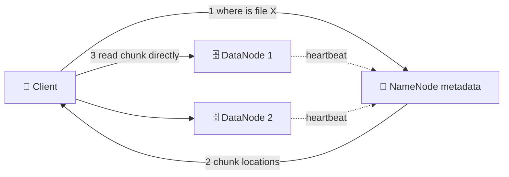

# 02 · Distributed File Systems

> [!info] Topic info
> **Subject:** System Design · **Chapter:** Storage Systems · **Priority:** 💤 Low · **Status:** ✅ done · **Last reviewed:** 2026-11-19
>
> [← Back to Storage Systems](README.md) · [Interview questions →](questions/storage-systems-qa.md)

> [!abstract] In one line
> A **distributed file system** (like **HDFS** or Google's **GFS**) spreads huge files across many machines as **big chunks**, keeps **3 copies** of each, and uses a central **metadata server** to know where every chunk lives.

---

## 1. The problem

Our app logs **5 TB of user activity per day**. We want to run analytics over a year of it — about 1.8 PB.

No single disk or server holds that. And with thousands of cheap disks, **a few die every day**. We need one big "file system" built from many machines that shrugs off failures.

---

## 2. How it works

Files are split into large **chunks** (HDFS: 128 MB). Each chunk is stored on **3 different machines**, ideally on different racks.

- **NameNode** (master) — keeps the **metadata**: file names, which chunks belong to a file, which servers hold each chunk. It does **not** carry the data.
- **DataNodes** — store the actual chunks and send **heartbeats** to the NameNode.

**Self-healing:** if a DataNode stops sending heartbeats, the NameNode sees chunks with only 2 copies and tells other nodes to make a 3rd.

**Data locality:** instead of moving 1 PB to the code, frameworks like [MapReduce](../big-data/03-mapreduce.md) run the code **on the machines that hold the chunks**.

> [!tip] 🎤 Say it like this
> "A DFS like HDFS splits big files into 128 MB chunks, keeps three replicas on different racks, and has a NameNode that only stores metadata. Clients ask the NameNode where chunks are, then read straight from the DataNodes. It's built for huge sequential reads in batch analytics, not small random writes."

---

## 3. When to use it

**✅ Good for:** huge files, write-once / read-many, batch analytics (Hadoop, Spark).

**❌ Bad for:** millions of tiny files (NameNode memory fills up), low-latency random reads, editing files in place.

> [!note] Today
> Many companies now keep the data lake on **object storage** (S3) instead of HDFS — cheaper, no servers to run. The chunk + replica + metadata idea is still how S3-like systems work inside.

> [!failure] Interview traps
> - Forgetting the NameNode is a [single point of failure](../core-concepts/04-single-point-of-failure.md) — real setups run a standby NameNode.
> - Thinking data flows through the NameNode. It only hands out locations.
> - Using HDFS to serve user photos to a website — wrong tool; use [object storage](03-object-storage.md) + a CDN.

---

## Summary

- Big files → **128 MB chunks** → **3 replicas** across racks.
- **NameNode** = metadata only. **DataNodes** = data + heartbeats.
- Built for **throughput** and batch jobs, not latency.

> [!success] Key takeaway
> Metadata server + big chunks + 3x replication = the core recipe behind GFS, HDFS, and most large storage systems.
