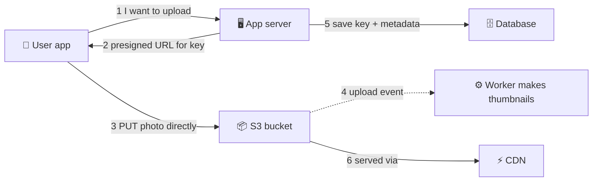

# 03 · Object Storage

> [!info] Topic info
> **Subject:** System Design · **Chapter:** Storage Systems · **Priority:** ⚡ Medium · **Status:** ✅ done · **Last reviewed:** 2026-11-19
>
> [← Back to Storage Systems](README.md) · [Interview questions →](questions/storage-systems-qa.md)

> [!abstract] In one line
> **Object storage** (like **AWS S3**) stores files as **objects** in a **flat namespace**, each found by a **key** inside a **bucket**, accessed over **HTTP** — cheap, extremely **durable**, and practically **unlimited**.

---

## 1. The problem

Users of our social media app upload **10 million photos a day** (~2 MB each = 20 TB/day). Storing them in the database bloats it. Storing them on app servers' disks breaks when we have 50 servers.

We need one place that holds **petabytes**, never loses a photo, and any server — or the user's phone — can reach.

---

## 2. How it works

- **Bucket** — a top-level container, e.g. `social-photos`.
- **Key** — the object's unique name, e.g. `users/42/posts/987.jpg`.
- **Object** — the bytes + **metadata** (content type, size, custom tags).

The namespace is **flat**. The `/` in the key only *looks* like folders — it's just part of the name. That's why it scales to trillions of objects.

You use simple HTTP calls: `PUT` to upload, `GET` to download, `DELETE` to remove. No partial edits — to change one byte you upload the whole object again.

> [!note] Durability vs availability
> S3 promises **11 nines of durability** (99.999999999%) — store 10 million objects and expect to lose one every ~10,000 years. It does this by copying data across **multiple AZs** (or [erasure coding](04-erasure-coding.md)). Availability (can I read it *right now*) is lower, ~99.99%.

For block vs file vs object, see the [comparison table](01-block-storage.md) (section 4).

---

## 3. Photo upload with presigned URLs

**Naive way:** phone → app server → S3. Every 2 MB photo passes through our servers, eating bandwidth and CPU for no reason.

**Better way — presigned URL:** the app server gives the client a **temporary signed URL** (e.g. valid 5 minutes, only for one key). The phone uploads **directly to S3**.

- The **database** stores only the key and metadata (who, when, caption), never the bytes.
- Reads go through a [CDN](../caching/05-cdn.md) so users get photos from a nearby edge.
- Downloads of private files can also use presigned GET URLs.

> [!tip] 🎤 Say it like this
> "Photos go to object storage, not the database. The app server hands the client a short-lived presigned URL, the client uploads straight to S3, and we store only the object key in the DB. An upload event triggers a worker to make thumbnails, and a CDN serves the reads."

---

## 4. Storage tiers and lifecycle rules

Most photos are hot for a week, then rarely viewed. Pay less for cold data:

| Tier | Use | Cost / retrieval |
|---|---|---|
| **Standard** | Recent, often read | Highest storage cost, instant |
| **Infrequent Access** | Read a few times a month | Cheaper, small fee per read |
| **Archive** (e.g. Glacier) | Backups, compliance | Very cheap, minutes to hours to read |

A **lifecycle rule** moves objects automatically, e.g. "after 30 days → Infrequent Access, after 1 year → Archive, delete temp uploads after 1 day".

**✅ Pros**
- Practically unlimited scale, very cheap per GB
- Extremely durable, built-in replication and versioning
- Accessible from anywhere over HTTP; pairs well with CDNs

**❌ Cons**
- Higher latency per request (tens of ms) — not a database or OS disk
- No in-place edits; whole object rewritten
- Listing/searching keys is slow — keep an index in your DB

> [!failure] Interview traps
> - Storing images as BLOBs in the database. Store the **key** in the DB, bytes in S3.
> - Uploading through the app server when a **presigned URL** would do.
> - Making a bucket public to "fix" access — use presigned URLs or a CDN with restricted access.
> - Forgetting lifecycle rules — storage bills grow forever.

---

## Summary

| Idea | What it gives you |
|---|---|
| **Bucket + key + metadata** | Flat namespace that scales to trillions of objects |
| **Multi-AZ copies** | 11 nines durability |
| **Presigned URLs** | Clients upload/download directly, servers stay light |
| **CDN in front** | Fast reads worldwide |
| **Lifecycle tiers** | Old data gets cheaper automatically |

> [!success] Key takeaway
> Big files (photos, videos, backups, logs) → object storage. Database keeps only the key. Clients upload with presigned URLs, users read through a CDN.
